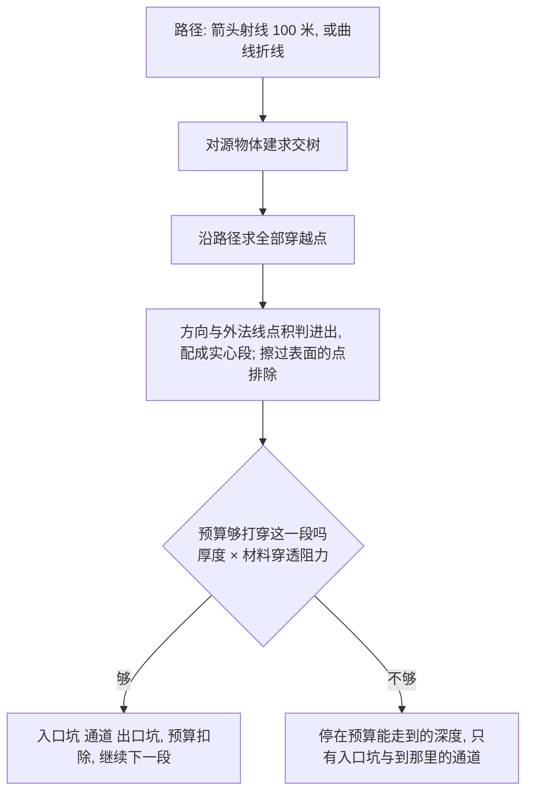

# Drivers - 破坏驱动

驱动决定哪些碎块在什么时候、以什么速度开始运动，以及哪些碎块根本不参与。驱动是一个普通的物体，参数挂在物体上：

- 移动、旋转、缩放物体就是在摆放作用范围；
- 视口里显示的球、箭头、圆环、立方体或曲线，就是真实的作用范围。

驱动只写自己，不改动任何资产。烘焙时由 [模拟烘焙](Simulation.md) 读取。

## 面板

```text
破坏驱动
  在 3D 游标处添加:
  [ 爆炸 ][ 推力 ]
  [ 选中受影响的碎块 ]
  ☑ 显示计划预览                           默认打开
      箭头比例  0.10                         预览打开时才可用
      ☑ 按起动时刻着色
  ▾ 活动驱动         活动物体是驱动时显示名字, 类型与参数; 是普通空物体时可以设为驱动
  ▾ 场景中的驱动     每个驱动一行: 名字按钮 (点击选中), 类型与起动帧, 删除按钮 ×; 停用的驱动置灰
```

新建的驱动放在场景根集合下的 `QD_Drivers` 集合里，起动帧默认取当前帧，但不早于场景起始帧之后的第一帧。

## 驱动类型

界面只提供 **爆炸** 与 **推力** 两种。旋涡、曲线方向、弹道与区域的数据与模拟仍然保留：旧文件里的这些驱动照常参与烘焙，在活动驱动与场景驱动列表里也照常显示和编辑参数，阶段 API `add_driver` 也仍能新建它们；只是面板上不再提供新建与转换的按钮。下文关于这四种类型的说明保留给已有的驱动与脚本使用。

| 类型 | 物体与外观 | 作用 |
| --- | --- | --- |
| 爆炸 | 空物体，球 | 把范围内的碎块从球心向外抛出 |
| 推力 | 空物体，单箭头 | 沿箭头方向推动范围内的碎块 |
| 旋涡 | 空物体，圆环 | 让范围内的碎块绕空物体的 Z 轴旋转，可同时向内收拢或沿轴抬升 |
| 曲线方向 | 曲线物体 | 把曲线附近的碎块沿曲线的方向带走 |
| 弹道 | 空物体箭头，或曲线物体 | 一发沿路径飞行的子弹，穿过源实体，在入口、通道与出口处推开碎块 |
| 区域 | 空物体，立方体 | 不给速度，只改变范围内碎块的激活方式 |

活动驱动的类型显示为只读文字，不能在面板上改成别的类型。选中任意普通空物体，可以在 **活动驱动** 子面板里把它设为爆炸或推力。曲线方向只能设在曲线上，弹道在空物体和曲线上都行，其余类型只能设在空物体上，这些约束对阶段 API 仍然有效。

## 作用范围

- **爆炸、推力、旋涡**：范围是半径为"空物体显示尺寸"的球，再乘以物体的变换。非等比缩放时是椭球，与视口显示一致；负缩放与父级变换也都会计入。**作用范围** 一行显示最大半径，按场景单位换算。
- **区域**：显示类型是立方体时按立方体判断（各轴取最大值），其他显示类型按椭球判断。
- **曲线方向**：范围是曲线周围半径为 **管半径** 的管。**管半径** 为 0 时取曲线的倒角深度乘缩放，倒角也是 0 时取 0.5。
- **弹道**：没有范围，由路径与三个半径（入口、通道、出口）决定，见下文。

## 参数

参数按用途分成几组，组与组之间留空。不同类型只显示自己用到的参数。

### 通用

| 组 | 参数 | 字段 | 默认 | 含义 |
| --- | --- | --- | --- | --- |
| — | 类型 | `role` | 无 | 驱动类型或无 |
| — | 启用 | `enabled` | 开 | 关闭后驱动留在场景里但不起作用 |
| 时间 | 起动帧 | `frame` | 10（新建的驱动取当前帧，见上） | 范围内的碎块在这一帧仍保持原位，从下一帧开始运动；弹道里是子弹发射的帧 |
| 时间 | 冲击波速度 | `wave_speed` | 0 m/s | 越远的碎块起动越晚：延迟帧数 = 距离 ÷ 波速 ÷ 每帧的模拟秒，向上取整；0 表示同时起动。曲线方向按碎块最近点沿曲线的距离算 |
| 强度 | 速度 | `speed` | 8 m/s | 全强度时碎块获得的速度，按模拟时间的每秒计 |
| 强度 | 衰减 | `falloff` | 平滑 | 恒定、线性、平滑或平方反比，见下文 |
| 强度 | 全速核心 | `core_ratio` | 0.2 | 范围中靠近中心、获得全速的部分 |
| 强度 | 质量响应 | `mass_response` | 0 | 速度乘 (参考质量 ÷ 碎块质量)^k；参考质量是这个资产碎块质量的中位数；系数限制在 0.1 到 10 之间；0 表示所有碎块速度相同 |
| 方向 | 随机锥角 | `spread` | 15° | 每块碎块方向在这个锥角内随机偏转，速度大小不变 |
| 自转 | 最大自转 | `max_spin` | 360° | 全强度时每秒的最大转角，绕随机轴 |
| 自转 | 随机种子 | `seed` | 0 | 不移动驱动也能换一组随机方向与自转 |

### 各类型专用

| 类型 | 参数 | 字段 | 默认 | 含义 |
| --- | --- | --- | --- | --- |
| 爆炸 | 上抛 | `lift` | 0.2 | 方向 = 归一化(径向单位向量 + 上抛 × 世界 Z) |
| 推力 | 仅前方 | `front_only` | 关 | 只推动箭头前方的碎块 |
| 旋涡 | 向内收拢 | `inward` | 0 | 速度中朝向轴的比例，负值向外 |
| 旋涡 | 抬升速度 | `rise` | 0 m/s | 全强度时沿轴方向的额外速度 |
| 曲线方向 | 管半径 | `tube_radius` | 0 | 碎块离曲线多近会被带走 |
| 曲线方向 | 吸附 | `attraction` | 0 | 速度中把碎块拉向曲线的比例 |
| 区域 | 区域内的碎块 | `zone_action` | 锚定 | 锚定、冻结、休眠、自由或排除，见下文 |
| 弹道 | 弹速 | `bullet_speed` | 400 m/s | 子弹的飞行速度，决定路径上各处何时被命中 |
| 弹道 | 穿透力 | `penetration` | 0.3 m | 能穿过的混凝土厚度 |
| 弹道 | 入口 / 通道 / 出口半径 | `entry_radius` `channel_radius` `exit_radius` | 0.15 / 0.05 / 0.4 m | 三类撞击的作用半径 |
| 弹道 | 入口 / 通道 / 出口速度 | `entry_speed` `channel_speed` `exit_speed` | 3 / 10 / 15 m/s | 三类撞击给碎块的速度 |
| 弹道 | 出口锥角 | `exit_spread` | 35° | 出口处碎块方向的随机锥角 |

**衰减**：设 u 为碎块质心在作用范围里的归一化距离（中心为 0，边缘为 1），c 为全速核心比例。u ≤ c 时强度为 1；之外令 s = (u − c) ÷ (1 − c)，强度为：

| 衰减 | 强度 |
| --- | --- |
| 恒定 | 1 |
| 线性 | 1 − s |
| 平滑 | 1 − (3s² − 2s³) |
| 平方反比 | (c ÷ u)²，在范围边缘截断；c 为 0 时按 0.05 计算 |

**随机量**：锥角与自转只由驱动的随机种子和碎块身份决定，与碎块的处理顺序无关，同样的场景每次烘焙结果相同。

**多个驱动**：

- 同一块碎块被几个驱动在同一帧起动时，速度相加；
- 起动帧不同时，先到的先起动，后到的在碎块运动途中再给它一个**速度增量**：新速度叠加在碎块当时的速度上，下落、滑动与自转都保留，不会被重置。

## 旋涡

- **方向**：取碎块相对轴的径向 r̂，切向 t̂ = 轴 × r̂（绕 +Z 轴逆时针）；方向 = 归一化(t̂ − 向内收拢 × r̂)，再在随机锥角内偏转；抬升速度沿轴加上去，不参与偏转。
- **恰在轴上的碎块**：没有径向，在垂直于轴的平面里随机取一个方向。

## 曲线方向

- **读取曲线**：只读第一条样条。贝塞尔按样条的分辨率逐段求值，多段线取控制点，NURBS 取控制点连线作近似。没有读求值后的网格，因为曲线有倒角时它是一根管子，不能当折线。
- **速度**：沿碎块最近点的切线方向，大小 = 速度 × 按到曲线的距离衰减后的强度；**吸附** 把方向朝曲线偏。
- **只决定初速度**：碎块飞出后不会贴着曲线走。

## 弹道

一发弹道由路径、源实体和资产的材料共同决定。



| 撞击 | 受影响的碎块 | 方向 | 速度 |
| --- | --- | --- | --- |
| 入口坑 | 入口点半径内 | 以镜面反射方向为轴的锥（朝外抛回） | 入口速度 |
| 通道 | 沿通道的圆柱内 | 沿弹道，锥角为随机锥角 | 通道速度 |
| 出口坑 | 出口点半径内 | 沿弹道，锥角为出口锥角 | 出口速度 |

- **时刻**：撞击的起动帧 = 发射帧 + 向上取整(累计长度 ÷ 弹速 ÷ 每帧的模拟秒)；通道按碎块在弹道上的投影处算。
- **穿透阻力**：由资产的材料决定（混凝土 1，金属 4，木材 0.3），在[物理设置](Physics.md)里调。穿透力相同时，金属比混凝土停得早。
- **路径起点在实体里**：补一个没有入口坑的隐含入口。
- **飞行动画**：弹道驱动的子物体沿路径飞行，发射帧之前停在原位，之后按弹速逐个折点写线性关键帧，停在嵌入点（或飞完整条路径）。动画写在 `QD_Flight_<驱动名>` 里，复位时放回原位。
- **要求**：资产的源物体必须还在，否则报"源物体已被删除"。求交用的是切割前的源网格，所以第二发子弹看不到第一发留下的缺口；缺口里的碎块已经起动，第二发命中时走途中再交接。

## 区域

区域不给碎块速度，只决定碎块的激活方式，优先级从高到低：

| 优先级 | 来源 | 结果 |
| --- | --- | --- |
| 1 | 区域：排除 | 碎块不参与模拟，不进刚体世界，不带动画，停在原位，其他物体也不与它碰撞 |
| 2 | 区域：锚定，或资产的底部锚定 | 始终不动的被动刚体 |
| 3 | 区域：冻结、休眠、自由 | 覆盖资产的默认激活方式；多个区域冲突时取名字靠后的 |
| 4 | 资产的默认激活方式 | 见[物理设置](Physics.md#受击前状态) |

判断用碎块质心是否在区域里。被覆盖为休眠的碎块仍会被其他驱动推动。

## 选中受影响的碎块与计划预览

- **选中受影响的碎块**：对选中的资产按当前驱动编译一遍计划，选中有起动事件的碎块；没有碎块受影响时不改动选择。资产必须已经应用物理。
- **显示计划预览**：给每块会被起动的碎块在视口里画一根箭头，起点是质心，方向与长度是起动速度（**箭头比例** 是每单位速度的长度）；打开 **按起动时刻着色** 时，最早起动的是蓝色，最晚的是红色。弹道另画路径（青色，到子弹最远飞到的位置）与入口（绿色）、出口（红色）十字标记。
- **预览的含义**：只表示交接时给出的速度与起动帧，不是碰撞之后的轨迹。它与烘焙使用同一个编译函数，所以看到的就是烘焙时用的初始条件；预览的帧范围与时间缩放取模拟烘焙的设置。
- **范围**：预览选中的资产；没有选中资产时预览场景里全部应用过物理的资产。
- **缓存**：驱动、选中的资产、物理修订号与预览设置都没变时直接复用上次的结果。

## 阶段 API

```python
import bpy

from bl_ext.user_default.quick_destruction.common import drivers
from bl_ext.user_default.quick_destruction.tools.Drivers.api import (
    add_driver,
    affected_shards,
    make_driver,
    plan_preview,
)

blast = add_driver(bpy.context, drivers.EXPLOSION, location=(0, 0, 1), frame=12, speed=10.0)
blast.scale = (2.0, 2.0, 2.0)
make_driver(bpy.data.objects["Empty"], drivers.PUSH)
shot = add_driver(bpy.context, drivers.PROJECTILE, location=(-3, 0, 1), penetration=0.5)
plans = plan_preview(bpy.context, roots)
hit = affected_shards(bpy.context, roots)
```

| 函数 | 说明 |
| --- | --- |
| `add_driver(context, role, *, location=None, **params)` | 新建驱动物体并返回它；`params` 经规格校验，不合法时新建的物体一并删除 |
| `make_driver(obj, role)` | 把已有物体设为驱动；物体类型与角色不匹配时报错 |
| `remove_driver(obj)` | 删除驱动物体：子物体解除父级并保持世界位置，只属于它的曲线数据一起删除；不是驱动的物体报错 |
| `plan_preview(context, roots)` | `{资产标识: {碎块路径: ShardPlan}}`，与烘焙同一个编译函数 |
| `affected_shards(context, roots)` | 有起动事件的碎块列表 |

## 边界

- 驱动按烘焙开始时的位置与参数读取，给驱动打关键帧不会生效。
- 驱动作用于场景里全部参与烘焙的资产；弹道的求交按资产逐个进行。
- 驱动给出的是碎块开始运动时的速度。之后的轨迹由物理模拟决定，会受碰撞、重力与阻尼影响。
- 曲线驱动只读第一条样条；NURBS 是控制点连线的近似。
- 箭头射线长 100 个世界单位；子弹速度很高时仍按弹速换算起动帧，不是真实的刚体飞行。
