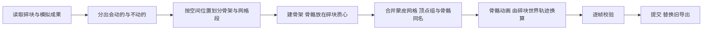

# GameExport - 游戏导出

把烘焙好的碎块动画变成游戏引擎能直接用的内容：
- 每块会动的碎块对应一根骨骼，所有碎块蒙到同一个（或几个）网格上，碎块的运动变成骨骼动画；
- 建好后逐帧检查蒙皮结果与碎块动画一致，再导出 FBX，供虚幻引擎与 Unity 导入。

流程分三步，对应面板上的三个按钮：**构建绑定 → 检查绑定 → 导出 FBX**。

## 面板

```text
游戏导出                                   [预设]
  Cube: 120 块碎块
  绑定      ✓ 输入未变
  导出      ○ 未完成
  1 个骨架，1 段网格，83 根骨骼，37 块静止碎块      上次构建的摘要
  ✓ 没有发现问题                                    检查后出现；有问题时逐条列出
  设置在上次构建后改过                              面板值与上次实际使用的不同时出现
  [        构建绑定        ]
  [ 检查绑定 ] [ 导出 FBX ]
  ▸ 绑定      静止距离, 静止角度, 每段网格骨骼数, 每个骨架骨骼数, 断面 UV, UV 缩放 (默认收起)
  ▾ 导出      引擎, 前向轴, 上方向轴, 应用缩放, 全局缩放, 导出目录, 文件名
```

## 参数

| 参数 | 字段 | 默认 / 范围 | 含义 |
| --- | --- | --- | --- |
| 静止距离 | `static_distance` | 0.001 | 整段动画里移动不超过它、转动不超过静止角度的碎块不分配骨骼，并入 root |
| 静止角度 | `static_angle` | 0.5° | 同上，转动的上限 |
| 每段网格骨骼数 | `max_bones_per_mesh` | 0（不限） | 一段蒙皮网格最多使用的骨骼数（含 root），超出时网格拆成多段；某些平台按网格分段计算骨骼调色板 |
| 每个骨架骨骼数 | `max_bones_total` | 0（不限） | 一个骨架最多的骨骼数（含 root），超出的碎块放进额外的骨架，**导出成多个文件** |
| 断面 UV | `interior_uv` | 盒投影 | 给切割新生成的断面生成 UV，引擎里可以给断面单独铺材质；保持不变则不动 |
| UV 缩放 | `interior_uv_scale` | 1.0 | 盒投影时每单位距离对应的 UV 长度 |
| 引擎 | `engine` | 通用 | 选择后自动填入下面的轴向与缩放，之后仍可修改 |
| 前向轴 / 上方向轴 | `axis_forward` / `axis_up` | -Z / Y | 导出文件里的方向；必须在不同的轴上 |
| 应用缩放 | `apply_scale` | 无 | 缩放写入文件的方式 |
| 全局缩放 | `global_scale` | 1.0 | 额外施加在全部内容上的缩放 |
| 导出目录 | `directory` | `//export/` | `//` 表示 blend 文件所在目录；blend 文件还没保存时必须用绝对路径 |
| 文件名 | `file_name` | `{asset}` | 不含扩展名；`{asset}` 换成源物体名，有多个骨架时再加序号；多写的 `.fbx` 会去掉，Windows 不允许的字符换成下划线，留空等同于默认 |

### 引擎预设

| 引擎 | 前向轴 | 上方向轴 | 应用缩放 | 全局缩放 |
| --- | --- | --- | --- | --- |
| 通用 | -Z | Y | 无 | 1.0 |
| 虚幻引擎 | -Y | Z | 场景单位 | 1.0 |
| Unity | -Z | Y | 全部 | 1.0 |

> **预设尚未在目标引擎里逐项验证。** 这些数值是各引擎常用的导出设置，在 Blender 里往返导入验证过动画与顶点位置，但没有在虚幻引擎与 Unity 里实际导入。第一次导出后请对照下面的清单检查，不符时改"自定义"并调整轴向与缩放。

## 构建的过程



- **骨骼**：一根 root，加每块会动的碎块一根。骨骼头部在碎块的静止质心，名字是 `b_` 加逐层序号（例如 `b_003_002`，只含 ASCII，不超过 63 字节）。路径过长时退回 `b_00000` 这样的顺序号，映射记在绑定记录里。
- **蒙皮**：每个顶点只受所属碎块的骨骼影响，权重 1；不动的碎块归 root。
- **动画**：碎块的世界位置与朝向逐帧换算成骨骼的姿态，线性关键帧，每帧一个，只写会动的骨骼。导出时不精简曲线。
- **保留**：所有碎块都进入蒙皮网格，材质、UV、顶点属性原样保留，不合并也不丢弃。
- **划分**：需要拆分时，按 Morton 序把空间上相近的碎块放在一起，按容量顺序切分，结果确定。
- **两阶段提交**：新绑定先建在临时集合里，校验通过后才删除旧的导出并改成最终名字；任何一步失败，旧导出、选择、活动物体与当前帧都原样保留。
- **旧绑定的清除**：重新烘焙或重置模拟时，基于旧成果建的导出集合（骨架、网格、动画）和导出记录会一并删除，不会留下对不上碎块动画的旧数据；已经写到磁盘上的 FBX 文件不动。需要时重新构建绑定即可。
- 产物在集合 `<源名>_Export` 里：骨架 `<源名>_Rig`、网格 `<源名>_RigMesh`，多个时加序号。

## 检查

检查只读数据。**错误**会让导出停止，**警告**只提示：

| 级别 | 检查 | 含义 |
| --- | --- | --- |
| 错误 | 碎块守恒 | 每块碎块的顶点数、面数、各材质面数与蒙皮网格里属于它的部分一致 |
| 错误 | 蒙皮一致 | 抽样帧上蒙皮后的顶点与碎块动画给出的世界顶点一致（构建时校验首尾与若干帧，测试按全部帧校验） |
| 错误 | 骨骼名 | 骨骼名只含 ASCII 且不超过 63 字节 |
| 错误 | 骨骼上限 | 每段网格与每个骨架的骨骼数没有超过设定上限 |
| 警告 | 绑定过期 | 物理重新应用过或设置已改，需要重建（重新烘焙与重置模拟会直接清除旧绑定） |
| 警告 | 变换 | 导出集合里的物体不是单位变换 |
| 警告 | 断面 UV | 断面没有 UV，或碎块没有断面标记（旧版本生成的碎块需要重新切割） |
| 警告 | 结算时间 | 最后一次起动距离结束不足 1 秒，碎块可能还没落定 |

## 导出

- 每个骨架连同它的网格写成一个文件：一个骨架时是 `<文件名>.fbx`，多个时是 `<文件名>_01.fbx`、`<文件名>_02.fbx`……；文件名默认是源物体名。
- **同时导出多个资产**：如果文件名没有 `{asset}`，几个资产会写到同一个文件，此时直接报错，一个文件都不写；把文件名改成含 `{asset}` 的形式（例如 `{asset}_Break`）即可。
- 目标文件已存在时先弹确认对话框；脚本调用需要显式 `overwrite=True`。
- 绑定过期或检查有错误时拒绝导出。
- 导出期间临时把场景帧范围设为模拟范围，并临时改变选择；结束后全部还原。
- 需要启用内置插件 **Import-Export: FBX format**。
- 固定参数：只导出骨架与网格，不加叶骨骼，只导出形变骨骼，逐帧烘焙动画且不精简，按面平滑。

## 引擎首次导入检查清单

1. **方向**：碎块没有躺倒或朝向颠倒；
2. **尺寸**：与场景里的实际大小一致（虚幻是厘米，Unity 是米，注意引擎是否又做了单位换算）；
3. **动画**：时间长度正确，起始帧碎块在静止姿态；帧率与场景一致；
4. **骨骼**：数量与面板摘要一致，没有出现多余的 `_end` 叶骨骼；
5. **材质**：材质槽与 Blender 里一致，断面用到的材质可以单独替换；
6. **骨骼上限**：目标平台有骨骼数限制时，用"每段网格骨骼数"与"每个骨架骨骼数"拆分后再导入。

## 阶段 API

```python
from bl_ext.user_default.quick_destruction.tools.GameExport.api import (
    build_rig,
    build_rig_steps,
    check,
    existing_files,
    export_fbx,
)

results = build_rig(bpy.context, [root], {"max_bones_per_mesh": 64})  # [RigResult]
issues = check(bpy.context, root, {})  # (Issue, ...)
paths, issues = export_fbx(
    bpy.context, root, {"engine": "UNREAL", "directory": "D:/out"}, overwrite=True
)
```

- 配置缺失字段取默认值，选了 `engine` 而没有给轴向时自动填入引擎的取值；
- `build_rig_steps` 是生成器，每个阶段产出一次进度，供可取消的界面任务使用；`build_rig` 同步执行到底；
- 构建与导出前都会检查运行锁：同一时间只允许一个长任务；
- 绑定记录与导出记录写在资产根集合的自定义属性上，状态由它们与模拟成果、物理记录比对得出。

## 已知限制

- 引擎预设没有在虚幻引擎与 Unity 里验证（见上）；
- 没有曲线精简（逐帧关键帧），碎块很多、帧数很长时文件较大；
- 碎块有父物体时拒绝构建，需要先解除父子关系；
- 不导出材质贴图，只保留材质槽。
