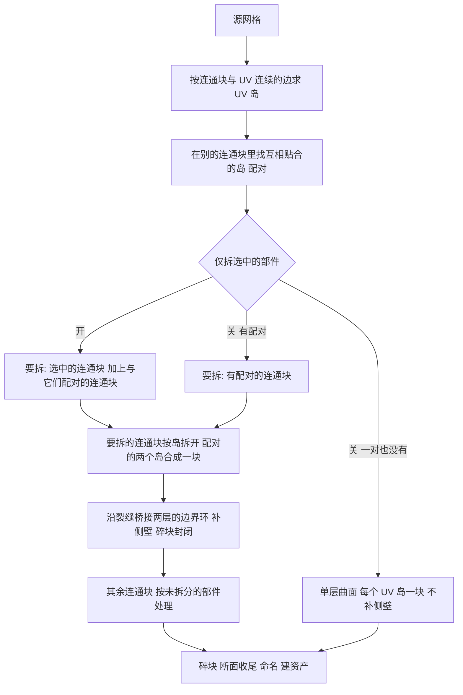

# MeshFracture - 网格破碎

流程：采样种子 → 在包围盒内构造 Voronoi 胞体 → 凸包 → 与源物体做 Exact 布尔求交 → 递归细分 → 断面收尾。

入口是侧栏 **QuickDestruction** 标签页里的 **MeshFracture／网格破碎** 面板：在物体模式下选中网格，在面板最上方选一种 **破碎方式**，再点它下面的生成按钮。源物体始终保留，生成成功后默认在视口与渲染里隐藏（见"输出"里的"隐藏源物体"），按 **Ctrl+Z** 可以撤销整次生成。

三种破碎方式是三页，切换后生成按钮与下面的子面板跟着换，只显示这一页用得到的参数：

| 页 | 生成按钮 | 这一页的子面板 | 说明 |
| --- | --- | --- | --- |
| 切割 | 生成碎块 | 切割种子来源、切割参数、递归破碎、胞体形状 | Voronoi 切割，本文大部分小节 |
| 部件 | 部件转碎块 | 无专属子面板，只用共用的"断面与碎块"和输出 | 见"部件转碎块" |
| UV 岛 | 按 UV 岛拆分 | 按 UV 岛拆分 | 见"按 UV 岛拆分"；也可以在编辑模式下点击 |

面板布局如下：

- **主面板**：破碎方式页签与当前页的生成按钮；选中物体所在的资产被复制过时，另有警告与 **重建副本身份** 按钮，见"资产身份"一节；
- **子面板**：当前页的子面板，加上各页共用的"断面与碎块"（默认收起；当前方式用不到的项置灰）；
- **底部按钮**：输出与调试很少调整，画成并排的弹出按钮，调试只在切割页出现；
- **标题栏**：预设入口在面板标题栏右侧；预设也会记住当前的破碎方式（`method`）。

破碎方式只决定面板显示哪一页；脚本里的 `generate_fragments`、`convert_parts`、`convert_uv_islands` 各管一种方式，不读它。

从"切割种子来源"一节开始，各节按面板从上到下的顺序说明参数。

## 输入要求

最好的输入是**封闭、无自相交**的网格：每条边正好连接两个面，面与面之间不互相穿插。

点击生成时，会先按求值后的网格（包含修改器）检查选中的物体：

| 问题 | 判定 | 后果 |
| --- | --- | --- |
| 不封闭 | 有开放边，一条边连接三个以上的面，或两部分只在一个顶点处相接 | 网格没有明确的内部，碎块可能出现缺口或开口 |
| 自相交 | 有互相穿插的面，例如 Suzanne 嵌在头里的眼睛 | 布尔求交可能丢失几何 |

- 体检发现问题时会弹出提示框，列出有问题的物体和后果，可以选择"仍然切割"或取消。自相交检查排除了共享顶点的面对，未发现问题不代表几何一定有效。
- 修复方法：在编辑模式里按"选择 > 按特征全选 > 非流形"找到开口并补面，合并互相穿插的部分；或者用"重构网格"里的体素重构直接得到封闭网格，再切割。
- 阶段 API 不弹窗，脚本可以先调用 `source_issues` 自行判断。

## 切割种子来源

| 参数 | 字段 | 默认 | 含义 |
| --- | --- | --- | --- |
| 切割种子来源 | `source` | 自身顶点，可多选 | 见下表；选中的来源一个点都没有时，回退到自身顶点 |

| 来源值 | 读取位置 |
| --- | --- |
| `VERT_OWN` 自身顶点 | 源网格修改器之前的原始顶点 |
| `VERT_CHILD` 子物体顶点 | 直接子物体的顶点；网格用原始顶点，其他可转换类型用求值几何 |
| `PARTICLE_OWN` 自身粒子 | 源物体全部粒子系统中所有粒子的当前位置，包括未出生与已死亡的粒子，不含子粒子 |
| `PARTICLE_CHILD` 子物体粒子 | 直接子物体全部粒子系统中所有粒子的当前位置，同样包括未出生与已死亡的粒子，不含子粒子 |
| `PENCIL` 注解铅笔 | 场景活动注解层在当前帧的笔画点，不读取蜡笔物体 |

- 种子数不等于碎块数：去重、退化胞体与空交集会减少块数，递归与孤岛拆分会增加块数。
- 默认立方体只有 8 个顶点，所以默认只有 8 个种子；把上限调高不会增加种子。

## 切割参数

| 参数 | 字段 | 默认 / 范围 | 含义 |
| --- | --- | --- | --- |
| 首次切割种子数 | `first_cut_seeds` | 100 / 0–5000 | 首次切割最多使用的种子数：去重前从种子来源里随机截取这么多种子，多出的丢弃，不会补点；每个种子最多产生一块，所以碎块数可能更少（种子重合、胞体落在物体之外都会少），拆分孤岛后也可能更多；不能超过碎块总数上限；0 表示跟随碎块总数上限，总数上限也为 0 时全部保留 |
| 碎块总数上限 | `recursion_clamp` | 250 / 0–10000 | 每个源物体的碎块总数上限，0 表示不设上限，否则不能低于首次切割种子数：首次切割的块数已计入它，每轮递归再按剩余预算规划，只有拆分孤岛可能超出，见"递归破碎"一节 |
| 种子扰动 | `source_noise` | 0.5 / 0–1 | 种子沿随机方向位移，最大为被切物体包围盒对角线 × 值 / 2；递归时按父碎块自身的大小扰动 |
| 随机种子 | `random_seed` | 0 / 0–2147483647 | 控制种子选取、种子扰动、递归选择与胞体顶点抖动；复现条件见"复现与边界" |
| 切面内缩量 | `margin` | 0.001 / 0–1 | 切割平面向内偏移的长度，每次切割（包括递归）都会应用，相邻碎块间隙约为它的 2 倍；实际使用的值不超过被切物体包围盒对角线的千分之一，所以小物体和递归里的小碎块不会被缝隙吃掉体积；设得过大仍会让胞体消失 |
| 填充实体 | `use_fill` | 开 | 关闭后嵌套的内层曲面被当作空腔，碎块只保留壳壁，详见下一节 |

### 填充实体

`use_fill`（填充实体，默认开）决定嵌套封闭曲面内部的空间算不算实体。

空心壳常由外层与内层两张封闭曲面组成，且两张面的法线都朝外。Exact 布尔按绕数判断内外：两层都朝外时内腔的绕数为 2，被当成实体填满，碎块就成了完整的实心块，直接穿过内腔。

| 状态 | 行为 |
| --- | --- |
| 开 | 与以前一致，按实体切割，内腔被填满 |
| 关 | 首次切割前按嵌套深度整理朝向：深度为偶数的封闭曲面朝外，奇数的朝内，内腔绕数回到 0；碎块只保留外层与内层之间的壳壁，不会伸进内腔，内腔表面按外表面处理，不算断面 |

- 嵌套深度由曲面表面上一点向三个方向发射射线，数穿过其他封闭曲面的次数的奇偶、按多数票决定；不封闭的曲面不参与判断，也不翻转。
- 只在网格含两个以上封闭曲面时才会处理；整理在求值后的网格副本上进行，源物体与它的网格不改动，切割结束后副本即被删除。内层本来就朝内、没有嵌套曲面的网格不建副本，开关没有差别。
- 只整理首次切割：递归的父块是上一次切割的产物，已经带着正确的内腔。
- 资产清单记下了这次切割是否把内层曲面当作空腔，绑定构建的[合并锚定碎块](Rig.md#合并锚定碎块)据此理解源物体：从源物体求静止整体时，同样把内层曲面翻成朝内。旧资产没有这条记录，按实体处理。
- 保留布尔修改器（调试）时修改器直接引用源物体，没有放副本的地方，此项不生效，界面置灰。
- 碎块体积为壳壁体积，后续物理设置按壳壁体积计算质量。

总数上限非零时，首次切割种子数不能超过它：界面调高种子数会同步抬高上限，调低上限会同步压低种子数；预设与阶段 API 违反此关系时按"无效参数"拒绝。递归预算按首次切割后的实际碎块数计算。

## 部件转碎块

模型本身已经由部件组成时（例如金蛋的 46 块封闭壳片），可以不切割，直接把部件当作碎块：切到 **部件** 页，点击 **部件转碎块**，得到的资产与切割完全一致，物理、驱动、模拟、绑定与导出都不用改。

| 选中 | 部件 |
| --- | --- |
| 一个网格物体 | 它的每个连通块（按共享边判断，只在顶点处相接的算不同块），顺序由面的下标决定，可复现；不属于任何面的游离点和边不进入碎块 |
| 多个物体 | 每个物体一块，部件由你自己决定；另外把它们合成一个 `<名字>_Whole` 作为资产的源物体（隐藏，放在资产根集合里），原物体切换与弹道都需要完整的源 |

**几何原样保留**：不切割、不修补、不丢弃任何部件，碎块数等于部件数。只取修改器求值后的网格，隐藏的面会取消隐藏（与切割一致）。

**与切割产出的碎块同一个样式**：

| 项目 | 部件转碎块 |
| --- | --- |
| 资产 | 同样的资产根集合、`<源物体>_Shards` 集合与清单；切割间隙 0，不空心 |
| 碎块标记与命名 | 路径 `(序号,)`，层级 1；命名规则、后缀与序号位数与切割相同。选中一个网格时名字是 `<网格名>_cell_001`；选中多个物体时碎块跟随各自的物体，例如物体 `Wing` 的碎块叫 `Wing_cell_002`（序号是整个资产里的编号，不是每个物体各自从 1 起），在大纲里能直接对回原物体 |
| 材质 | 材质槽与源物体一致（含"对象/数据"链接方式）；**断面材质** 与切割相同：断面材质索引指向最后一个槽之后时，碎块多一个 `<第一个材质名>_Interior` 槽，同名材质复用 |
| 断面面属性 | 总是写 `qd_interior`，值全为假（部件的面都是模型自带的）；源网格已有的该属性原样保留 |
| 断面顶点组 | 勾选"断面顶点组"时建立空的 `Interior` 顶点组，与切割一致 |
| 原点 | 勾选"重设原点"时移到顶点平均位置，世界位置不变 |

不适用的项：切割产生的新面才有"平滑断面"和"锐边"，部件没有新面，所以这两项在部件页置灰；切割后的共面面合并也不做，因为部件的拓扑是你自己的。

**重叠只告警，不修复**：生成后会检测部件之间是否重叠，有重叠时在状态栏给出警告，列出前几对碎块的名字，几何不做任何改动。模拟里互相穿插的碰撞体会被猛地推开，看到警告时应当回到模型里自己处理。判定分两种：

- **穿插**：一个部件的边穿过另一个部件的表面，并且两端离表面都超过较小部件包围盒对角线的万分之一；面与面只是贴着、共边或擦过不算；
- **包住**：表面互不相交，但一个部件整个在另一个**封闭**部件里面；不封闭的部件没有明确的内外，不判这种重叠。

脚本用 `convert_parts(context, sources, config)`，返回与 `generate_fragments` 相同的结果对象，其中 `overlaps` 是互相重叠的碎块对。其他规则：

- **只有一个连通块的网格**会被拒绝，提示用"生成碎块"切割，或选中多个物体；
- 选中的物体里有没有面的网格时报错，整次转换不会留下半成品；
- 沿用的参数：断面材质，断面顶点组，输出集合，隐藏源物体，碎块后缀与序号位数，重设原点；切割相关的参数不起作用。

**性能**（合成数据，Blender 5.2，每项一次实测）：

| 场景 | 旧实现（不处理重叠） | 现在（含重叠检测） |
| --- | --- | --- |
| 100 个二十面球合成一个网格，12.8 万面 | 10.9 秒 | 2.0 秒 |
| 27 个二十面球，3.5 万面 | 0.50 秒 | 0.26 秒 |
| 3000 个立方体合成一个网格，面贴面排成网格 | 3.5 秒 | 2.5 秒 |

旧实现每个部件都复制并处理整个网格，耗时随"部件数 × 面数"增长；现在只扫描一遍面角分块，再递归对半拆分，耗时随"面数 × 部件数的对数"增长。旧实现默认还会用 Exact 布尔处理重叠（金蛋 46 块约 2 秒，此表的旧实现一列已经关掉了这一步），现在没有这一步。三个场景里重叠检测都没有找到重叠；面贴面的网格是检测最坏的情况，每对相邻部件都要逐对排除。

**已知限制**：

- 大而弯的薄壳片用凸包碰撞体，凸包会鼓成透镜形，相邻片的凸包仍然互相重叠，这与碎块几何是否重叠无关，也不会触发告警。这类部件建议保持冻结，或者先把大片壳再切小（压平凸包）；
- 选中多个物体时，每个物体算一块，物体本身含多个互不相连的部分也不会被拆开；
- 穿入深度小于容差的轻微穿插不会告警。

## 按 UV 岛拆分

美术已经沿裂纹切好 UV 时（例如金蛋 02：外壳与内壳各 12 个 UV 岛，沿网格边的锯齿裂缝），可以不切割，每个 UV 岛直接成为一块碎块：切到 **UV 岛** 页，点击 **按 UV 岛拆分**。资产与切割完全一致，物理、驱动、模拟、绑定与导出都不用改。

**只拆选中的部件**（例如只拆蛋壳，底座保留）：

1. 进入编辑模式，把鼠标指向蛋壳按 **L** 选中它（选中部件上的任意一个面就够，整个连通部件都算选中）；
2. 在“按 UV 岛拆分”子面板里勾选 **仅拆选中的部件**，“未拆分的部件”选 **合成一块**；
3. 直接点 **按 UV 岛拆分**：在编辑模式下点击时会先回到物体模式再拆。

只选外壳一层就够：与它配对的内壳会一起拆，否则内壳会整块留下。



| 步骤 | 规则 | 依据 |
| --- | --- | --- |
| UV 岛 | 两个面共享一条边，且这条边两端在两个面里的 UV 坐标都相同（误差 1e-5），就算同一个岛 | 与 Blender 的 UV 岛定义一致；锐边不参与判断 |
| 配对 | 岛 A 的面积里至少 90% 落在另一个连通块的岛 B 的间距范围内，两岛面积比不低于 0.5，两层背对背，并且 A、B 互为最佳 | 见下面的配对条件 |
| 拆分 | 关闭“仅拆选中的部件”时，只有含配对岛的连通块按岛拆开；开启时从选中的连通块出发，沿配对关系一直扩到不再增加，三层以上的结构每一层都会拆；选中的连通块没有配对时每个 UV 岛单独成块、不补侧壁 | 装饰件与底座各自也有 1 到 3 个 UV 岛，自动判断时不会被拆开；只扩一层时第三层的面会同时进两块碎块 |
| 侧壁 | 只在配对的两个岛之间补侧壁：两个岛的边界环按整条环的平均距离从近到远两两桥接；侧壁按断面处理：断面属性、断面材质、平滑断面、锐边与断面顶点组都与切割一致 | 内壳常已沿裂缝断开，原有开放边也参与桥接；按中心距离配环会把同心的外轮廓与孔接错；并入的部件不在岛对里，它自己的开放边保持原样；没有对应环的孔洞保持开放 |
| 检查 | 桥接之后检查配对岛这部分有没有开放边、侧壁两侧走向是否相反；不满足的碎块列在结果的 `open_shards` 里，界面报警告并列出名字 | 桥接失败时 `bridge_loops` 可能既不报错也不生成面，不检查就会静默留下有缺口的碎块 |

配对条件：

| 条件 | 取值 | 依据 |
| --- | --- | --- |
| 最大间距 | 岛所在连通块包围盒对角线的 5% | 壳厚不随碎片大小变化；按岛的对角线算时，碎片对角线小于壳厚二十倍就配不上对（合成测试：壳厚 0.03、碎片对角线约 0.3，全部 66 对配上） |
| 不重合 | 两层间距大于最大间距的千分之一 | 重合的双面几何没有厚度，不是薄壳 |
| 背对背 | 从对面最近点指向本面的方向与本面法线夹角小于 60°，与对面法线夹角大于 120° | 外层法线朝外、内层法线朝内腔；同向叠放的衬里与法线翻错的内层不会被当作薄壳，也就不会补出朝向错乱的侧壁 |
| 覆盖率与面积比 | 90%；0.5 | 排除贴在大岛上的小装饰面；总面积不到一半的连通块直接跳过，不做逐面查询 |

金蛋 02 的 12 对内外岛按这些条件配对的纯度都是 100%。

**侧壁 UV 展开成长条**：每段侧壁（一对边界环之间桥接出来的一圈）单独展开成一个 UV 岛：

| 方向 | 取值 |
| --- | --- |
| U | 沿裂缝的弧长（按其中一个岛的边界环量），闭合的一圈在起点处留一条接缝 |
| V | 到这条边界环的距离，即壳厚 |
| 尺度 | 都按世界长度乘 **侧壁条带 UV 缩放**（每米的 UV 长度），贴图密度处处相同，不拉伸 |
| 摆放 | 同一块碎块的几条条带从原点起上下错开，中间留出与条带同宽的空隙，互不重叠 |
| 写入 | 每一个 UV 层都写同一套条带坐标；展开过的侧壁面带 `qd_interior_uv` 标记，绑定构建的盒投影跳过它们，不会覆盖 |

条带只决定侧壁在 UV 上的形状，取到贴图的哪一块要靠材质配合：侧壁通常应当用单独的断面材质（断面材质索引填源物体最后一个槽之后的序号即自动建立，见"断面与碎块"），配平铺的断面贴图。侧壁和外表面共用一张图集或调色板贴图时，条带落在 UV 原点附近，取到的颜色不一定合适。

| 参数 | 字段 | 默认 | 含义 |
| --- | --- | --- | --- |
| UV 贴图 | `uv_map` | 空 | 用哪一套 UV 的岛，留空使用活动 UV。金蛋 02 的 `UVmap_0` 有 12 个岛，`LightMapUV` 有 11 个（两个小岛合在一起） |
| 仅拆选中的部件 | `use_uv_selected` | 关 | 只拆含选中面的连通部件，选择取自编辑模式（物体模式下看不到，开启时面板会提示）；一个面也没选中时报错 |
| 侧壁条带 UV 缩放 | `strip_uv_scale` | 1.0 | 侧壁长条每米对应的 UV 长度；1.0 时 1 mm 厚、50 cm 长的侧壁是 0.001 × 0.5 的长条 |
| 未拆分的部件 | `uv_unsplit` | 并入 | **并入**：每个不拆的连通块并入离它的顶点最近的碎块（装饰件随壳片飞出，底座并入最下面的壳片）；**各自成块**：每个不拆的连通块单独一块；**合成一块**：全部不拆的连通块合成一块，适合底座整体保留、在物理里锚定 |
- 每个选中的网格物体各自成一个资产；外表面的面、UV 与材质原样保留。
- 沿用的参数：断面材质索引、平滑断面、锐边、断面顶点组、输出集合、隐藏源物体、碎块后缀与序号位数、重设原点；切割相关的参数不起作用。
- 完成后的报告写明拆开了多少个部件，例如“已按 UV 岛生成 13 个碎块，拆开了 38 个部件中的 2 个”，可以核对选择是否如预期；有没能封闭的碎块时改为警告并列出名字。
- 报错：没有 UV、指定的 UV 不存在、只有一个 UV 岛时拒绝，不留下数据；在编辑模式下点击而失败时回到编辑模式，选择保留。
- 每块碎块只从它自己的面建网格（按分组递归对半拆开），耗时随面数近似线性增长：两层各 20480 面、约 140 块、外加 300 个小部件约 1.8 秒。
- 脚本用 `convert_uv_islands(context, sources, config)`，返回与 `generate_fragments` 相同的结果对象，另外填写 `open_shards`、`split_parts` 与 `total_parts`。
- 自动测试：`tests/blender/verify_uv_split.py` 用合成薄壳逐条核对小碎片配对、同心环、并入不封闭部件、衬里与双面、三层选择、缺口提示、编辑模式失败恢复与耗时。

**金蛋 02 实测**（Blender 5.2.2，脚本 `tmp/script/verify_uv_islands.py`）：

| 项目 | 结果 |
| --- | --- |
| 拆分耗时 | 0.12 秒 |
| 碎块 | 12 块，全部封闭、法线一致；原网格 5243 个面全部保留且只出现一次，两套 UV 都在 |
| 侧壁 | 每块 13 到 55 个侧壁面；每片壳一条侧壁长条，长 28 到 96 cm、宽约 1 mm，12 条合计约 7.2 m（每条裂缝由两片壳各算一次，裂缝总长约 3.6 m） |
| 体积 | 合计 3104 cm³；底座并入最下面的壳片 |
| 各自成块 | 48 块（12 块壳片，35 件装饰，1 个底座），全部封闭 |
| 合成一块 | 13 块：12 块壳片加 1 块底座与装饰，全部封闭 |
| 仅拆选中的部件 | 只选外壳上的一个面：内壳随配对一起拆，得到 13 块（合成一块）；在编辑模式下点击按钮同样得到 13 块，结束后回到物体模式 |
| 全流程 | 物理、驱动、模拟、绑定（默认、合并锚定碎块、原物体切换）、导出（含终局姿态文件）都通过，逐帧蒙皮误差 2e-6 |

**已知限制**：

- 侧壁条带写进每一个 UV 层，光照贴图层里条带与外表面的 UV 会重叠；引擎通常会重新生成光照贴图 UV，需要用自带光照贴图层时要另外处理；
- 只有薄壳配对补出来的侧壁会展开成条带；切割（生成碎块）产生的断面仍由绑定构建做盒投影；
- 底座并入后，最下面一块的凸包碰撞体包含底座，物理里建议把它锚定；
- 配对阈值在金蛋 02 与合成薄壳上验证过；壳厚超过所在部件包围盒对角线 5% 的模型不会被当作薄壳，此时每个岛单独成块且不补侧壁；
- 大而弯的壳片用凸包碰撞体时互相重叠的问题仍在，见“部件转碎块”的已知限制。

## 递归破碎

| 参数 | 字段 | 默认 / 范围 | 含义 |
| --- | --- | --- | --- |
| 细分轮数 | `recursion` | 1 / 0–20 | 首次切割之后的细分轮数；首次切割是第 1 层，每轮细分加一层 |
| 每块切割上限 | `sub_cut_pieces` | 8 / 2–5000 | 递归时每个碎块最多切成的块数：去重前从碎块自己的顶点里随机截取这么多种子，每个种子最多产生一块，所以实际块数可能更少，拆分孤岛后也可能更多；最小为 2，只有 1 个种子时碎块只会把自己重切一遍；父碎块没有粒子与子物体，除非选中注解铅笔，种子就是它自己的顶点，超过顶点数后不再有变化 |
| 每轮细分比例 | `recursion_chance` | 1 / 0–1 | 每轮细分的碎块数 = 向下取整(当前碎块数 × 比例) |
| 细分优先级 | `recursion_chance_select` | `SIZE_MAX` 大碎块 | 无法把所有碎块都切满时如何分配细分，见下表 |
| 保留父碎块 | `use_keep_parents` | 关 | 关闭时细分成功后删除父碎块；开启时父碎块按层移进 `<源物体>_Parents` 下的 `<源物体>_Parents_L<层>`，带 `_qd_parent` 标记，不再参与之后的递归，也不计入生成结果 |

细分优先级只在两种情况下起作用：每轮细分比例小于 1，或碎块总数上限放不下完整的一轮。

| 优先级 | 分配方式 |
| --- | --- |
| `EVEN` 无 - 平均细分 | 上限放不下整轮时，让每块都细分一些，块数平均分配，余下的先给较大的碎块；比例小于 1 时挑较大的碎块 |
| `RANDOM` 随机 | 随机挑碎块切满 |
| `SIZE_MIN` / `SIZE_MAX` 小碎块 / 大碎块 | 按世界包围盒对角线从小到大 / 从大到小依次切满 |
| `CURSOR_MIN` / `CURSOR_MAX` 靠近 / 远离游标 | 按原点离 3D 游标由近到远 / 由远到近依次切满 |

**每一轮的规划**：

首次切割的种子数按"首次切割种子数"截取，为 0 时按"碎块总数上限"截取；每个种子最多产生一块，而首次切割种子数不会超过总数上限，所以首次切割的块数已经计入总数上限，剩下的预算才留给递归。

1. 按每轮细分比例挑出候选；比例为 1 时取全部碎块。
2. 算出每个候选最多切成几块：每块切割上限与它的可用点数取小，每个种子最多产生一块。
3. 全部候选切满也不超过碎块总数上限时，整轮照常切完。
4. 否则按细分优先级在上限内分配：平均细分让每块都切一些，其余优先级按顺序切满，最后一块只切到剩余的块数。
5. 整轮一次规划好再切，避免在轮中途按列表顺序截断；没切到的碎块会在下一轮重新参与规划。

例如首次切割 30 块、每块可切 8 块、上限 80：平均细分给 20 块各分配 3 块、另外 10 块各分配 2 块；大碎块优先给最大的 7 块各分配 8 块、第 8 块分配 2 块，其余 22 块不切。两种计划都是 80 块，实际产出仍受空交集、去重和孤岛拆分影响。

一次生成的最终碎块总数硬上限为 10000，不计保留的父碎块与调试物体。超出时报错并尝试回收本次生成的数据；这项限制不能保证复杂几何的处理时间。

- 每轮开始前按计划种子上限和可用点数估算碎块数，超过硬上限就提前拒绝；估算未计孤岛拆分，拆分后的实际数量另行检查。去重或空交集也可能使实际数量低于估算值。
- 递归时临时排除已完成碎块，各批父块统一刷新并取回布尔结果，每轮批量删除被替换的数据，以减少依赖图和删除开销。开启"实时显示进度"时停用隔离。
- 高面数源网格通常会增加布尔开销，可先用低模验证参数。

## 胞体形状

| 参数 | 字段 | 默认 / 范围 | 含义 |
| --- | --- | --- | --- |
| 分割轴权重 | `cell_scale` | (1, 1, 1) / 每轴 0.001–1 | 切割平面的轴向权重，只有三轴之间的比例起作用，某一轴权重越小，碎块沿该轴越长；不缩放物体，三轴相等时等同于普通 Voronoi；权重差异较大时，剪枝效果可能降低 |

## 断面与碎块

| 参数 | 字段 | 默认 / 范围 | 含义 |
| --- | --- | --- | --- |
| 断面材质索引 | `material_index` | 0 / ≥ 0 | 断面（包括递归切割产生的断面）使用的材质槽，从 0 开始。填源物体最后一个槽之后的那个序号（源物体有 1 个槽就填 1）时自动建断面材质，见下文；更靠后的序号报错 |

**自动断面材质**：断面材质索引正好是源物体最后一个槽之后的那个序号时：

- 碎块的材质槽在源物体的槽之后多一个，放入名为 `<第一个材质名>_Interior` 的材质（例如 `Ml_Prop_GoldenEgg_Interior`）；源物体没有任何材质时这样填会报错。
- 同名材质已经存在就直接复用，重复切割不会生成 `.001`；新建的材质是浅暖灰的占位色（粗糙度 0.8），在引擎里换成真正的断面材质即可。
- 只改碎块，不改源物体：源物体的材质槽保持原样。递归切割时父碎块已经有这个槽，不会重复添加。
- 切割与按 UV 岛拆分都适用；失败回滚时新建的材质也一起删除。
| 平滑断面 | `use_smooth_faces` | 关 | 断面平滑着色；外表面沿用源物体的着色 |
| 锐边 | `use_sharp_edges` | 开 | 把断面与外表面的交界边标为锐边 |
| 断面顶点组 | `use_interior_vgroup` | 关 | 创建 `Interior` 顶点组，只给断面独占的顶点赋权重 1 |
| 拆分孤岛 | `use_island_split` | 开 | 把不连通的部分拆成独立碎块，只在顶点处相接的部分也算不连通；拆分后不保证是凸体 |
| 重设原点 | `use_recenter` | 开 | 原点移到顶点平均位置，世界几何不动；之后应用物理时，物理设置会再把原点移到体积质心 |

- 碎块复制源物体的材质槽与 UV、颜色层，保留 UV 活动、渲染、克隆层及颜色活动、渲染层选择。外表面数据由布尔插值传递，断面 UV 不展开；保留布尔模式的外表面数据仍由修改器求值。
- 锐边只做标记，不拆开几何，不会让封闭的碎块变得不水密。
- 焊接距离为被切物体包围盒对角线 × 1e-4；切面内缩量的上限、共面容差、相交容差与包围盒外扩都随物体尺寸缩放（对角线不小于 1 的物体用默认值，不受影响），所以同样的种子分布在不同尺寸下切出相同的块数。物体更小时体积保留约 97.5%，缝隙占比不变；缩放物体后仍不保证得到逐位相同的结果。

## 输出（弹出按钮）

| 参数 | 字段 | 默认 / 范围 | 含义 |
| --- | --- | --- | --- |
| 集合 | `collection_name` | `cell_collection` | 空名使用当前集合；否则按名查找，找不到时新建。集合必须可编辑，并且在当前视图层可见；每个源物体在其中有自己的集合，见下文 |
| 隐藏源物体 | `hide_source` | 开 | 全部源物体都切割成功后，在视口（大纲里的眼睛图标）与渲染中隐藏它们；生成失败时不隐藏。源物体不在当前视图层里时只隐藏渲染。点亮眼睛图标即可重新显示；绑定构建的"原物体切换"读取隐藏的源物体不受影响 |
| 碎块后缀 | `shard_suffix` | `cell` | 碎块名里加在源物体名之后的后缀，为空时省略 |
| 序号位数 | `shard_index_padding` | 3 / 0–8 | 名字里每段序号的最小补零位数，位数更多的序号不截断 |

**命名规则**：

- 碎块名由源物体名、后缀与每层一段序号组成，序号段数就是层级：
  - `Cube_cell_003` 是首次切割（第 1 层）的第 3 块；
  - `Cube_cell_003_002` 是从 `Cube_cell_003` 再切出的第 2 块（第 2 层）；去掉最后一段就是父碎块的名字。
- 大纲默认按名字排序，同一父块切出的碎块自然排在一起。
- 每个源物体在输出集合里有自己的集合，全部最终碎块集中在 `<源物体>_Shards` 里，可在大纲中对该集合执行"选择物体"来选中全部碎块：

  ```
  cell_collection
  └─ Cube
     ├─ Cube_Shards              全部最终碎块
     │    Cube_cell_001, Cube_cell_002_001, Cube_cell_002_002 …
     └─ Cube_Parents             只在开启"保留父碎块"时出现
        ├─ Cube_Parents_L1       Cube_cell_002 …        首次切割后又被细分的碎块
        └─ Cube_Parents_L2       Cube_cell_002_001 …    第 2 层又被细分的碎块
  ```
- 显示种子生成的 `DebugPoints` 放在源物体集合里，不混进碎块集合。
- 源物体名在名字里最多占 64 字节（UTF-8）：
  - 前 64 字节相同的几个源仍可能撞名；
  - Blender 5.2 的数据块名上限是 255 字节，默认后缀与序号位数下很深的层级也不会被截断。
- 重复切割同一源时，旧碎块仍然保留，新碎块的名字由 Blender 加后缀区分。

名字不是稳定的身份标识。下游脚本应按碎块上的标记筛选：`_qd_source`（生成时的源名）、`_qd_level`（层级，首次切割为 1）、`_qd_path`（逐层序号，去掉最后一项就是父碎块的路径）、`_qd_asset`（所属资产的标识），保留的父碎块另带 `_qd_parent`。

## 资产身份

每个源物体的一次切割结果是一个**破碎资产**，以源物体集合（上图里的 `Cube`）为根：

| 写在哪里 | 内容 |
| --- | --- |
| 源物体集合 | 资产标识（每次切割新生成）、清单格式版本、源物体引用（源物体改名后仍有效）、生成时的源名、切割间隙 |
| 每块碎块与父碎块 | 同一个资产标识；碎块身份 = 资产标识 + 路径 |

- **按资产工作**：后续的物理设置、模拟烘焙都按资产工作，选中资产里任意一块碎块即可。同一源切多次会得到互不影响的多个资产。
- **复制资产**：在大纲里复制资产集合会连同标识一起复制，两个资产共用一个标识。其他工具会拒绝处理它们。选中副本里的物体后，主面板会显示"此资产被复制过"并给出 **重建副本身份** 按钮：副本换一个新标识，它的物理与模拟记录同时清除。
- **拒绝的情况**：旧版本生成、没有资产标识的碎块，以及格式版本未知的资产，都会被拒绝，需要重新生成。
- **API 结果**：`generate_fragments` 的结果新增 `source_to_asset`，即"源物体 → 资产根集合"的映射，可以直接交给后续工具的 API。

## 调试（弹出按钮）

| 参数 | 字段 | 默认 | 含义 |
| --- | --- | --- | --- |
| 实时显示进度 | `use_debug_redraw` | 关 | 切割过程中逐胞体重绘，被切物体临时显示为线框，并停用隔离与父块批处理；后台模式跳过视口重绘，其余处理差异仍存在 |
| 显示种子 | `use_debug_points` | 关 | 每次切割（包括递归）生成一个 `DebugPoints` 物体，显示扰动后的种子，不计入碎块 |
| 保留布尔修改器 | `use_debug_bool` | 关 | 在凸胞体上保留布尔修改器，并跳过递归、孤岛拆分、共面面合并与断面收尾 |

## 复现与边界

- **复现**：在同一 Blender 版本下，保持源物体名字、几何、变换、修改器、种子来源、当前帧、游标位置及参数一致。多个源按名字排序并共享随机流，增删或改名源物体可能改变后续结果；API 提供自定义 `rng` 时还需保持其初始状态一致。
- **预设**：保存在扩展用户目录的 `presets/mesh_fracture/`。
  - 缺少的字段保留界面当前值；
  - 未知字段、其他工具的预设与不支持的格式都会被拒绝；
  - 载入可以用 **Ctrl+Z** 撤销。
- **源网格**：
  - 开启锐边或断面顶点组时，切割期间会临时清除源网格的面隐藏标记，结束后还原；共享同一网格的物体在切割期间也会看到这一变化；
  - 来自链接库的网格无法改写，需要关闭这两项才能切割。
- **布尔**：
  - 按实际的求值网格判断，开放或非流形的输入会启用 Hole Tolerant；
  - 非有限坐标直接报错；明显超出源包围盒时开启自交处理重试一次，仍失败则报错并尝试回收本次产物，不修补源几何。
  - **内外复核**：Exact 求交在关闭自交处理时偶尔会把整块胞体的内外判反，与被切物体确实相交的胞体得到空结果（碎块缺一块），或落在外面的胞体得到整块结果（多出一块）。所以空结果与整块结果都要复核：两者表面相交时结果一定是部分交集；表面不相交时看胞体中心在不在被切物体里。判错时开启自交处理重算这一块。始终开启自交处理也能避免，但切割会慢 4 到 12 倍；复核只在少数胞体上重算，默认参数切割圆环耗时基本不变。检查不证明凹形体内包含，也不保证水密；失败恢复边界见[阶段 API](../开发文档/Architecture.md#阶段-api)。
- **阶段 API**：脚本调用方式见[架构文档](../开发文档/Architecture.md#阶段-api)。缺少的字段取默认值，未知字段会被拒绝。
- **版本**：只支持 Blender 5.2 及以上。
