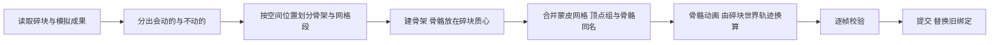

# Rig - 绑定构建

把烘焙好的碎块动画变成游戏引擎能直接用的骨骼动画：
- 默认每块碎块对应一根骨骼（可以改成只给会动的碎块绑骨骼），所有碎块蒙到同一个（或几个）网格上，碎块的运动变成骨骼动画；
- 建好后逐帧检查蒙皮结果与碎块动画一致；校验不通过的绑定不会提交。

建好的绑定由 [游戏导出](GameExport.md) 写成 FBX。流程是：**构建绑定 →（可选）检查绑定 → 在游戏导出面板导出 FBX**。

## 面板

```text
绑定构建                                   [预设]
  Cube: 120 块碎块
  绑定      ✓ 输入未变
  1 个骨架，1 段网格，83 根骨骼，37 块静止碎块      上次构建的摘要
  待机 2 帧；破碎动画里原物体第 0 帧隐藏，碎块第 0 帧出现    绑定方式为原物体切换时出现
  ✓ 没有发现问题                                    检查后出现；有问题时逐条列出
  设置在上次构建后改过                              面板值与上次实际使用的不同时出现
  [        构建绑定        ]                        主按钮
  [        检查绑定        ]
  ▾ 绑定设置
      绑定方式, 绑定静止碎块, 合并锚定碎块, 隐藏缩放, 待机长度, 原物体隐藏帧, 碎块出现帧    后四项只在原物体切换时可用
      ▸ 详细设置 (默认收起)
          静止距离, 静止角度
          每段网格骨骼数, 每个骨架骨骼数
          断面 UV, UV 缩放
          仅允许 ASCII 名称
```

## 参数

| 参数 | 字段 | 默认 / 范围 | 含义 |
| --- | --- | --- | --- |
| 绑定方式 | `rig_mode` | 仅碎块 | **仅碎块**：只导出碎块，第一帧起可见。**原物体切换**：另外导出完整的源物体，分成待机与破碎两段动画、两个文件，见下文 |
| 绑定静止碎块 | `bind_still` | 开 | 不动的碎块（被锚定的，或没被波及的冻结碎块）是否也有自己的骨骼。**开**：每块碎块一根骨骼，骨架只由碎块决定，与这次模拟里哪些碎块会动无关，不同模拟的动画可以共用同一套骨架，见下文"共用骨架"。**关**：不动的碎块没有骨骼，并入 root（原物体切换时并入 `still`），骨架更小，但骨架随模拟变化 |
| 合并锚定碎块 | `merge_anchored` | 关 | 锚定与排除的碎块是否合成与源物体一致的一整块，只用一根骨骼，详见下文"合并锚定碎块" |
| 隐藏缩放 | `hidden_scale` | 0.001 / 0–0.5 | 原物体切换时被隐藏一方的缩放 |
| 待机长度 | `idle_length` | 2 / 不小于 1 | 待机动画的长度，帧 |
| 原物体隐藏帧 | `intact_hide_frame` | 0 | 破碎动画里源物体从这一帧起缩到隐藏缩放 |
| 碎块出现帧 | `shards_show_frame` | 0 | 破碎动画里碎块从这一帧起恢复原尺寸 |
| 静止距离 | `static_distance` | 0.001 | 整段动画里移动不超过它、转动不超过静止角度的碎块算作静止：没有动画关键帧；关闭"绑定静止碎块"时也没有骨骼，并入 root |
| 静止角度 | `static_angle` | 0.5° | 同上，转动的上限 |
| 每段网格骨骼数 | `max_bones_per_mesh` | 0（不限） | 一段蒙皮网格最多使用的骨骼数（含 root），超出时网格拆成多段；某些平台按网格分段计算骨骼调色板 |
| 每个骨架骨骼数 | `max_bones_total` | 0（不限） | 一个骨架最多的骨骼数（含 root），超出的碎块放进额外的骨架，**导出成多个文件**；原物体切换时每个骨架另留 2 根，上限至少为 4 |
| 断面 UV | `interior_uv` | 盒投影 | 给切割新生成的断面生成 UV，引擎里可以给断面单独铺材质；保持不变则不动。已经展开过的断面（带 `qd_interior_uv` 标记，例如按 UV 岛拆分展开成长条的侧壁）不做盒投影，保留原来的 UV |
| UV 缩放 | `interior_uv_scale` | 1.0 | 盒投影时每单位距离对应的 UV 长度 |
| 仅允许 ASCII 名称 | `ascii_names` | 开 | 资产名（源物体名）、材质名含 ASCII 以外的字符时拒绝构建；导出时按构建时的选择再查一次文件名、导出物体名与材质名。部分引擎无法导入这类名称 |

## 构建的过程



- **骨骼**：一根 root，加每块有骨骼的碎块一根：默认是全部碎块，关闭"绑定静止碎块"时只有会动的碎块。骨骼头部在碎块的静止质心，名字平铺编号：`b_001`、`b_002`……按碎块路径的顺序编号，不足三位补零，碎块超过 999 块时照写四位以上；骨骼到碎块的映射记在绑定记录里。
- **蒙皮**：每个顶点只受所属碎块的骨骼影响，权重 1；没有骨骼的不动碎块归 root。root 没有顶点时不建 root 顶点组。
- **动画**：碎块的世界位置与朝向逐帧换算成骨骼的姿态，线性关键帧，每帧一个，只写会动的骨骼；绑了骨骼的不动碎块没有关键帧，停在静止姿态。
- **骨骼数**：绑定静止碎块会让骨骼数等于碎块数加 root（原物体切换再加 `origin`），骨骼上限的拆分按全部碎块计算；碎块很多而又只有少数会动时，关闭它可以得到小得多的骨架。
- **保留**：所有碎块都进入蒙皮网格，材质、UV、顶点属性原样保留，不合并也不丢弃。
- **划分**：需要拆分时，按 Morton 序把空间上相近的碎块放在一起，按容量顺序切分，结果确定。
- **两阶段提交**：新绑定先建在临时集合里，校验通过后才删除旧绑定并改成最终名字；任何一步失败，旧绑定、选择、活动物体与当前帧都原样保留。
- **旧绑定的清除**：重新烘焙或重置模拟时，基于旧成果建的导出集合（骨架、网格、动画）和导出记录会一并删除，不会留下对不上碎块动画的旧数据；已经写到磁盘上的 FBX 文件不动。只删除插件生成的物体：自己放进导出集合的物体保留，集合里还有它们时集合也保留；被别的物体共用的网格数据不删。
- 产物在集合 `<源名>_Export` 里（场景里已有同名集合时 Blender 会加 `.001`，文件名不受影响，仍取源物体名）：骨架 `<源名>_Rig`、网格 `<源名>_RigMesh`，多个时加序号；原物体切换时另有 `<源名>_Intact`，每个骨架另有待机动作 `QD_Rig_<骨架名>_Idle`。

## 共用骨架

打开"绑定静止碎块"时，骨骼名、骨骼数与骨骼头部位置只由碎块的路径顺序与静止姿态决定，不依赖这次模拟里哪些碎块会动。同一个资产用不同驱动、不同锚定烘焙出多种破碎效果时，每次构建得到的骨架完全相同，只有动画（关键帧）不同，引擎里一套骨架可以播放它们。

- **前提**：碎块本身与它们的静止姿态不变，骨骼上限设置也不变；重新切割，或让静止姿态改变（例如物理设置把原点移到体积质心的结果变了），骨架就会不同。
- **动画怎么对应**：每个动画只给会动的骨骼写位置与旋转关键帧，没有关键帧的骨骼停在静止姿态，所以同一骨架可以接任意一次模拟的动画。
- **关闭时**：只有会动的碎块有骨骼，骨骼编号按会动碎块顺序排列，不同模拟的骨架不同，不能共用。

## 原物体切换

绑定方式选 **原物体切换** 时，绑定里另有完整的原物体，每个骨架有两段动画，[游戏导出](GameExport.md)把它们写成两个文件：

| 动画 | 文件 | 内容 |
| --- | --- | --- |
| 待机 | `<文件名>_Idle.fbx` | 静止循环：只显示原物体，碎块都缩到隐藏缩放，会动碎块的骨骼停在静止姿态；从烘焙起始帧开始，长度是"待机长度" |
| 破碎 | `<文件名>_Destruction.fbx` | 与仅碎块相同的破碎动画，另按两个开关帧切换原物体与碎块，范围是整段模拟 |

引擎里先循环播放待机动画，需要破碎时切到破碎动画。破碎动画里的两个时机分开设置：

| 帧 | 原物体 | 碎块 |
| --- | --- | --- |
| 原物体隐藏帧之前 | 缩放 1，显示 | — |
| 原物体隐藏帧起 | 隐藏缩放（默认 0.001） | — |
| 碎块出现帧之前 | — | 隐藏缩放（默认 0.001） |
| 碎块出现帧起 | — | 缩放 1，播放破碎动画 |

- **默认时机**：两帧都是第 0 帧，也就是烘焙起始帧：破碎动画一开始原物体就隐藏、碎块就显示，原物体只在待机动画里出现。第 0 帧碎块都在静止姿态，拼起来的形状与原物体相同，从待机切到破碎时看不出跳变。
- **自定义**：两帧可以不同。碎块出现帧早于原物体隐藏帧时两者重叠几帧，可以盖住替换瞬间；晚于时中间空几帧。驱动起动帧很晚时，可以把两帧都设成起动帧，让破碎动画开头一段仍是原物体。
- **不晚于烘焙起始帧**：原物体隐藏帧不晚于起始帧时，原物体从第一帧起就隐藏；碎块出现帧不晚于起始帧时，碎块从第一帧起就显示。
- **两段动画打同样的通道**：待机动作给会动碎块的骨骼也打静止姿态的位置与旋转关键帧，缩放开关的骨骼与破碎动作相同。导出时没有关键帧的通道会沿用上一个动作留下的姿态，所以两段动画必须覆盖同一批通道。
- **超出烘焙结束帧**：导出只写模拟范围内的帧，开关帧晚于结束帧时，导出的动画里看不到这一次切换。
- **原物体**：构建时读取源物体求值后的网格（带修改器的结果，与视口一致）与它当时的世界位置，做成网格 `<源名>_Intact`，全部顶点归骨骼 `origin`。源物体隐藏了也能读取；被删除时拒绝构建。构建后移动或修改源物体需要重新构建。
- **骨骼**：第一个骨架在 root 下多出 `origin`（原物体）与 `still`（没有骨骼的不动碎块，没有这样的碎块时不建，所以默认绑定静止碎块时没有 `still`）两根骨骼，头部都在资产中心。没有骨骼的不动碎块改归 `still`，因为它们也要在出现帧之前隐藏，不能留在 root 上；绑了骨骼的不动碎块像会动的碎块一样，在出现帧之前缩到隐藏缩放。
- **隐藏缩放**：被隐藏的一方默认不缩到 0，因为虚幻引擎不接受 0 缩放的骨骼。代价是隐藏的一方仍是原尺寸千分之一的小块：出现帧之前每块碎块缩在自己的质心处，藏在原物体内部看不见；隐藏帧之后原物体缩成资产中心的一个小点，碎块飞散后可能露出来。不需要导入虚幻引擎时可以设为 0。
- **缩放的写法**：缩放是骨骼上的常量插值关键帧：破碎动作只有起始帧与开关帧两个，待机动作只有起止两帧。原物体与不动碎块绕资产中心缩放，会动的碎块绕各自的质心缩放。
- **引擎里的插值**：FBX 按整帧烘焙动画，引擎在相邻两帧之间线性插值，所以在开关帧前一帧与开关帧之间的这一帧时长里，原物体会缩小、碎块会放大。每块都绕自己的中心缩放，看起来是一次很快的替换。
- **骨骼上限**：每个骨架都按 3 根固定骨骼（root、origin、still）预留，所以"每个骨架骨骼数"至少要设为 4；默认绑定静止碎块时没有 `still`，预留的这一根不会被用到。
- **检查**：逐帧蒙皮核对只看碎块出现帧及之后的帧；原物体网格没有来源属性，不参与碎块守恒与断面 UV 检查。

## 合并锚定碎块

被锚定的碎块（物理设置的底部锚定，或驱动区域的锚定）与被区域排除的碎块，设计上就不会动。它们拼在一起时碎块之间隔着切割间隙，能看到接缝，每块还要一根骨骼或一份几何。打开 **合并锚定碎块** 后，它们在构建时合成**一整块**：表面与未破碎的源物体完全一致，没有接缝，只用一根骨骼。


- **谁算锚定**：烘焙时由物理设置与驱动区域决定，写进模拟记录的 `anchored`（碎块序号）。它与这次驱动怎样撞击无关，所以同一套锚定设置下的不同模拟结果一致。旧版本烘焙的成果没有这个字段，需要重新烘焙；没有锚定碎块时开关不起作用。
- **从源物体出发，不是从碎片出发**：静止整体取自源物体（求值后的网格），不处理锚定碎块自己的几何。先把源物体裁到锚定碎块的包围盒（外扩两个外扩距离），再减去范围内的非锚定碎块，不碰到这个范围的碎块不参与，所以耗时只随锚定碎块周围的碎块数增长。
- **外扩**：被减去的碎块各向外扩 0.8 个切割间隙（取资产记录的间隙）：每个顶点按相邻面求位移，使每个相邻面的平面各自外移，断面的权重远大于外表面。相邻碎块因此重叠约 0.6 个间隙，不留间隙，不会在源物体里留下薄膜；外表面仍是源物体自己的几何，材质与 UV 也来自源物体。不取整个间隙：外扩的面会与邻块自己的面正好共面，Exact 求交在浮点误差下会得到碎裂的结果（圆环上实测）。
- **结果**：静止整体与其余碎块一起进蒙皮网格（第一个骨架的第一段），全部顶点权重 1，仅碎块时归 `root`，原物体切换时归 `still`；不在源物体表面上的面是断面，按"断面 UV"的设置做盒投影。被合并的碎块没有骨骼，也不逐块进蒙皮网格。
- **骨架共用**：锚定碎块不占骨骼，其余碎块按"绑定静止碎块"的设置各有一根（默认是），骨骼编号只在非锚定碎块里按路径顺序排列。这个集合不随模拟变化，所以同一套锚定设置下的不同模拟仍共用同一套骨架。
- **和其余碎块之间**：静止整体的断面与相邻碎块的断面之间保留原来的切割间隙，与源物体破碎时一致。
- **实测**（间隙 2 mm，底部锚定）：
  - 立方体切成 250 块，锚定 55 块：静止整体是 1 个连通块，约 310 个面，没有非流形边，断面几乎都贴着非锚定碎块，体积是锚定碎块之和的 1.01 倍；从锚定碎块出发（外扩后求并再与源物体求交）得到 569 个面且有口袋状残缺，所以不用这种做法；构建多用约 6 秒，碎块更多时更久；
  - 圆环（凹体）切成 212 块，锚定 131 块：1 个连通块，没有非流形边，体积 1.02 倍；
  - egg 空心壳关闭填充后切成 48 块，锚定 11 块：1 个连通块，没有非流形边，体积 1.005 倍，内腔没有被填。
- **检查与导出**：检查不再逐块核对被合并的碎块，逐帧蒙皮核对也跳过静止整体（它静止不动，外表面来自源物体）。导出时它与其他蒙皮网格一样写进文件，[终局姿态文件](GameExport.md#终局姿态文件)里也包含它。
- **限制**：
  - 静止整体取自构建时源物体的样子，构建后移动或修改源物体需要重新构建；源物体被删除时拒绝构建；
  - 不保证水密：多块碎块交汇的个别地方可能残留面积极小的断面，体积极小的游离碎片会被去掉；
  - 源物体是空心壳（嵌套的内外两层曲面）时，要在切割时关闭"填充实体"：资产清单记下了这一点，求静止整体时源物体里的内层曲面据此翻成朝内，内腔才不会被当成实体；
  - 源物体比立方体、圆环、egg 更复杂时（自相交、开放网格）尚未验证；
  - 只合并设计上静止的碎块；没被波及的冻结碎块与偶然没动的碎块按"绑定静止碎块"处理。

## 检查

检查只读数据。构建时自动做一次，**错误**会让构建失败、不提交；面板上的 **检查绑定** 可以在之后随时再做一次，例如改动过导出集合里的物体后。**警告**只提示：

| 级别 | 检查 | 含义 |
| --- | --- | --- |
| 错误 | 碎块守恒 | 每块碎块的顶点数、面数、各材质面数与蒙皮网格里属于它的部分一致 |
| 错误 | 蒙皮一致 | 抽样帧上蒙皮后的顶点与碎块动画给出的世界顶点一致（构建时校验首尾与若干帧，测试按全部帧校验） |
| 错误 | 骨骼名 | 骨骼名只含 ASCII 且不超过 63 字节 |
| 错误 | 骨骼上限 | 每段网格与每个骨架的骨骼数没有超过设定上限 |
| 错误 | 待机动作 | 原物体切换的每个骨架都带待机动作；丢了需要重新构建 |
| 警告 | 绑定过期 | 物理重新应用过、模拟成果变了或导出集合被删，需要重建（重新烘焙与重置模拟会直接清除旧绑定；面板上的"设置在上次构建后改过"是另一回事，只提示参数与上次构建时不同） |
| 警告 | 变换 | 导出集合里的物体不是单位变换 |
| 警告 | 断面 UV | 断面没有 UV，或碎块没有断面标记（旧版本生成的碎块需要重新切割） |
| 警告 | 结算时间 | 最后一次起动距离结束不足 1 秒，碎块可能还没落定 |

## 阶段 API

```python
from bl_ext.user_default.quick_destruction.tools.Rig.api import build_rig, build_rig_steps, check

results = build_rig(bpy.context, [root], {"max_bones_per_mesh": 64})  # [RigResult]
issues = check(bpy.context, root, {})  # (Issue, ...)
swap = {"rig_mode": "SWAP", "idle_length": 10, "intact_hide_frame": 12, "shards_show_frame": 12}
build_rig(bpy.context, [root], swap)
```

- 配置缺失字段取默认值，未知字段报错；
- `build_rig_steps` 是生成器，每个阶段产出一次进度，供可取消的界面任务使用；`build_rig` 同步执行到底；
- 构建前检查运行锁：同一时间只允许一个长任务；
- 绑定记录写在资产根集合的自定义属性上，状态由它与模拟成果、物理记录比对得出。

## 已知限制

- 碎块有父物体时拒绝构建，需要先解除父子关系；
- 原物体切换在引擎里有一帧时长的缩放过渡（见上），不能做到绝对瞬间；
- 原物体切换使用构建时源物体的样子，之后改动源物体需要重新构建。
