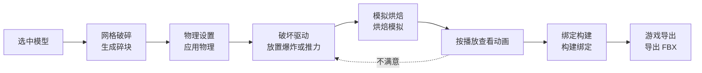

# 快速上手：从模型到破碎动画

四个工具按侧栏 **QuickDestruction** 标签页里的顺序使用，一次完整流程只需要几分钟。

## 一次完整流程

1. **切割**：在物体模式下选中网格，打开 **网格破碎** 面板，点击 **生成碎块**。碎块放在 `cell_collection/<源物体>/<源物体>_Shards` 里。这个源物体集合就是一个**破碎资产**，后面的工具都按资产工作。
2. **应用物理**：选中资产里任意一块碎块，在 **物理设置** 面板选材料，再选择 **受击前状态**：
   - 默认 **休眠**：冲击会在碎块之间传递，适合大多数爆炸；
   - 只想炸开局部、让其余部分原样留着时选 **冻结**；
   - 空中的物体选 **自由**。

   然后点击 **应用物理**。
3. **放驱动**：在 **破坏驱动** 面板点击 **爆炸** 或 **推力**，驱动会出现在 3D 游标处。用移动与缩放把它摆好，显示出来的球或箭头就是作用范围。在 **活动驱动** 子面板里调整起动帧与速度。
4. **烘焙**：需要地面时先点击 **添加预设地面**（有厚度的静态刚体，碎块不会掉到地板以下）。选中碎块，在 **模拟烘焙** 面板点击 **烘焙模拟**（默认烘焙第 0 到 90 帧，不跟随场景帧范围，可在"帧范围"子面板里改；第 0 帧碎块处于静止姿态）。视口会逐帧显示模拟过程，按 **Esc** 可以取消，场景会回到烘焙之前。
5. **查看**：按播放查看动画。碎块已经移出刚体世界，动画完全由关键帧驱动，可以随意拖动时间轴。
6. **导出到游戏引擎**：满意后在 **绑定构建** 面板点击 **构建绑定**（想先显示完整的原物体再破碎，把绑定方式改成"原物体切换"），再在 **游戏导出** 面板点击 **导出 FBX**，在引擎里导入生成的 FBX 文件。引擎预设尚未在引擎里逐项验证，首次导入请对照[游戏导出](GameExport.md#引擎首次导入检查清单)的清单。

## 修改与重来

| 想改什么 | 怎么做 |
| --- | --- |
| 驱动的位置、范围或速度 | 直接改驱动，再点 **烘焙模拟**；面板状态会显示"已过期：驱动已改动"提醒你重烘 |
| 材料或受击前状态 | 改 **物理设置** 后点 **应用物理**，再重新烘焙 |
| 重新烘焙或改了设置后导出 | 面板状态显示绑定已过期；重新 **构建绑定** 再导出，旧的导出集合会被替换 |
| 回到烘焙之前 | 在 **模拟烘焙** 面板点 **重置模拟**，碎块回到静止姿态 |
| 碎块被手动挪过，想以新位置为起点 | 先 **重置模拟**，再在 **物理设置** 点 **设为静止姿态** |
| 复制了整个资产集合 | 其他工具会拒绝处理副本；在 **网格破碎** 面板点 **重建副本身份** |

## 面板上的状态

物理设置、模拟烘焙、绑定构建与游戏导出面板的顶部会显示当前资产在这一步的状态：

| 状态 | 含义 |
| --- | --- |
| 未完成 | 这一步还没做过 |
| 已过期 | 做过，但之后它依赖的东西变了；下一行写明原因 |
| 输入未变 | 做过，且记录下来的输入都没变 |

状态只追踪经过插件的改动。在 Blender 自带面板里手动改碎块的刚体属性不会被追踪，所以最好的状态叫"输入未变"，而不是"最新"。

## 需要知道的边界

- **冻结的碎块不会因失去支撑而塌落**：只有被驱动波及的碎块会动；没被波及的冻结碎块一直不动，飞来的碎块撞上它也会被挡住。
- **驱动按烘焙开始时的状态读取**：给驱动打关键帧不会生效。
- **子弹一类的高速物体不能直接用刚体模拟**：Blender 的刚体系统没有开放连续碰撞检测，太快的物体会穿过薄的碎块。
- **只支持 Blender 5.2 及以上**。

各工具的详细说明：

- [网格破碎](MeshFracture.md)
- [物理设置](Physics.md)
- [破坏驱动](Drivers.md)
- [模拟烘焙](Simulation.md)
- [绑定构建](Rig.md)
- [游戏导出](GameExport.md)
