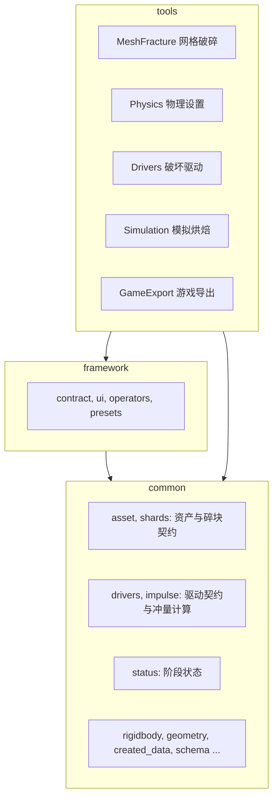

# 架构与接口

## 分层

```text
source/
  __init__.py        扩展入口, 延迟导入装配模块
  registration.py    工具清单, 场景参数组与挂载参数组的生成, 注册校验, 翻译合并与注册清理
  framework/         工具契约, 通用预设, 面板与算子基类, 参数绘制, 阶段状态行与资产摘要
  common/            多个工具共用的机制与数据契约
  tools/<Tool>/      业务工具, 一个工具一个包
```



- **依赖方向**：项目内部依赖方向为 `tools → framework → common`，工具也可以直接使用 `common`。
- **跨工具交流**：工具之间不互相导入，跨工具的数据都经 `common` 的契约模块读写。
- **守卫测试**：`tests/unit/test_guards.py` 用 AST 检查三条规则：
  - 工具代码里不出现 `_qd_` 开头的字面量；
  - 工具之间不互相导入；
  - `common` 不导入 `framework` 与 `tools`，`framework` 不导入 `tools`。
- **可单测的模块**：纯参数与纯计算模块（`schema`、`impulse`、`drivers` 的规格与快照、各工具的 `settings`）在模块顶层不导入 Blender，可以脱离 Blender 测试。

### common 模块

| 模块 | 职责 |
| --- | --- |
| `schema.py` | 参数规格：RNA 定义、读取、校验、预设写回 |
| `shards.py` | 碎块标记：来源、层级、路径、所属资产、父碎块、静止姿态；只用下标访问，不依赖 Blender |
| `asset.py` | 资产契约：创建资产、从选中物体解析资产、重复与旧数据检测、按资产取碎块、静止矩阵、物理与模拟的生效记录、场景的会话记录 |
| `drivers.py` | 驱动契约：驱动参数规格 `DRIVER_SCHEMA`（六种角色）、各角色显示的字段、驱动快照 `DriverSnapshot` 与摘要、曲线读成折线 |
| `impulse.py` | 冲量模型：把驱动快照与碎块信息编译成每块碎块的激活方式与起动事件（旋涡、曲线方向、质量响应、区域优先级、撞击事件）；纯计算 |
| `ballistics.py` | 弹道：穿越点配对、穿透预算、入口坑与通道与出口坑的撞击作用；纯计算 |
| `planning.py` | 计划编译的输入：读出碎块数值，弹道对源网格求交，子步建议；模拟与驱动预览共用 |
| `busy.py` | 运行锁：同一时间只有一个模拟任务，物理设置与模拟烘焙共用 |
| `status.py` | 阶段状态：物理与模拟的未完成、已过期（附原因）、输入未变；会话签名 |
| `rigidbody.py` | 刚体世界：确保世界与成员集合、点缓存检查、批量加入与移出、删除刚体、模拟步长 |
| `geometry.py` | 网格几何量：封闭性、带符号体积与体积质心、凸包体积 |
| `created_data.py` | `CreatedData` 登记本次新建的数据，失败时回收；`WriteLog` 记录对已有数据的改动，失败或取消时撤回 |
| `blender_context.py`、`errors.py`、`translate.py`、`localization.py` | BMesh 与选择的上下文管理、领域错误、取词、语言文件加载 |

## 工具接入

1. 在 `tools/` 下建立包，`__init__.py` 只写文档字符串。
2. 在 `tool.py` 声明 `TOOL`；有场景参数的工具在 `settings.py` 定义 `SCHEMA`，挂到其他数据块上的参数规格列在 `settings.OBJECT_SCHEMAS`。
3. 在 `registration.py` 导入声明并加入 `TOOLS`。移除工具时同时删除导入、清单项与工具包。

```python
TOOL = ToolSpec(
    tool_id="drivers",
    locales=Path(__file__).with_name("locales"),
    classes=CLASSES,
    attachments=(Attachment(bpy.types.Object, "qd_driver", DRIVER_SCHEMA),),
)
```

| 字段 | 含义 |
| --- | --- |
| `tool_id` | 唯一标识，以小写字母开头，后接小写字母、数字或下划线；派生 `Scene.qd_settings.<tool_id>`、`presets/<tool_id>` 和翻译上下文 `QuickDestruction.<tool_id>` |
| `locales` | 工具语言文件目录 |
| `classes` | 按注册顺序排列的类，包括生成的参数面板 |
| `schema` | 场景参数规格；`None` 表示没有场景参数组 |
| `presets` | 启用通用预设，要求提供 `schema` |
| `attachments` | 挂在其他数据块类型上的参数组：`Attachment(目标类型, 属性名, 规格)`；属性名必须以 `qd_` 开头，注册层生成 `QD_PG_<tool_id>_<属性名去掉 qd_>` 并挂上指针 |

| 接入约定 | 要求 |
| --- | --- |
| 命名 | 工具类使用 `QD_<TOOL_ID大写>_` 前缀，算子 ID 使用 `qd_<tool_id>.`；注册前检查标识、类名、`bl_idname` 与挂载属性重复 |
| 面板 | 继承 `ToolPanel` 与 Blender `Panel`；主面板设置 `tool_id`，带预设时由 `draw_header_preset` 绘制标题栏入口 |
| 算子 | 继承 `ToolOperator` 与 Blender `Operator`，实现 `run(context)`；返回的非空文本作为 INFO 报告，可按需要增加 `invoke`、`modal` 等回调 |
| 翻译 | 手写面板、菜单与算子声明英文 `bl_description`，规则见[翻译文档](Translations.md) |

`TOOLS` 决定工具注册及侧栏排列顺序，当前为网格破碎、物理设置、破坏驱动、模拟烘焙。注册层依次登记以下内容：

1. 翻译；
2. 类；
3. `Scene.qd_settings`；
4. 挂载参数组；
5. 预设。

注册失败或注销时逆序尝试清理，单步失败仍继续其他步骤并打印堆栈。仍然失败的逆操作留在记录里，下次停用时再试，不会丢失。

## 参数与界面

`Schema` 统一参数的 RNA 定义、读取、校验和预设写回。字段的约束与联动写在规格里：
- 字段顺序约束在 `orders` 中声明；
- 字段级 `update` 回调直接写在规格的关键字参数里，例如物理设置的材料下拉。预设按规格顺序写入，所以联动字段要排在被它改写的字段之前。

- **布局**：主面板放资产摘要、状态与主按钮，其余参数用 `ParamGroup` 分组。`closed=True` 默认收起，`popover=True` 在底部生成弹出按钮。
- **生成**：`parameter_panels(parent, schema, core, groups, active)` 返回面板类，并检查每个参数恰好列入一次。
- **绘制**：
  - `draw_fields` 将标签与数值分列，向量分量并排；
  - `CheckGrid((字段名, ...))` 将布尔字段排成两列；
  - `Expand(字段名, labeled=True)` 把枚举画成并排按钮，`labeled=False` 时不画标签、占满整行，用于子面板标题已经说明了含义的字段。
- **自绘**：分组可提供 `draw(layout, owner)`，仍需在字段表列出所绘字段，以便检查。
- **生效条件**：`active(owner, key)` 为假时只置灰，仍可编辑。标签应简短，不重复分组标题。
- **资产摘要与状态**：
  - `draw_assets(layout, context)` 由选中物体解析资产，画出"名字：N 块碎块"，失败时画出原因；
  - `draw_stage_status(layout, title, status)` 画状态行，已过期时原因另起一行。

## 错误与预设

`ToolOperator` 将执行异常报告为"<操作>失败：<原因>"，返回 `CANCELLED`。
- **领域错误**：使用 `DomainError`，按声明的上下文翻译消息和术语；`common` 里的领域错误没有声明上下文，按框架上下文翻译。
- **参数错误**：参数校验失败使用 `InvalidParameterError`。
- **其他异常**：显示原始文本并打印堆栈。

业务数据的回滚由工具负责。

通用预设提供 `qd.preset_save`、`qd.preset_load`、`qd.preset_remove`、`qd.preset_open_directory` 和 `QD_MT_presets`。隐藏参数 `tool_id` 定位当前场景参数组；菜单通过布局上下文接收标识，绘制期间不写 ID 数据。

文件位于扩展用户目录的 `presets/<tool_id>/`，与扩展代码目录分开。名称经过净化，写入采用同目录临时文件替换，读取上限为 1 MiB。格式为：

```json
{"format_version": 1, "tool_id": "mesh_fracture", "values": {"first_cut_seeds": 100}}
```

保存全部参数；载入先检查格式、版本和工具标识，再由 `Schema.write` 校验写入，缺失字段保留当前值。
- **恢复**：遇到 `TypeError`、`ValueError` 或 `RuntimeError` 时尝试恢复待写字段的原值，恢复本身失败仍会抛错。
- **撤销**：载入支持撤销；保存、删除和打开目录不进入撤销栈。

## 资产与碎块契约

每个源物体的一次切割结果是一个**破碎资产**，以源物体集合为根。资产身份是根集合上的 UUID，碎块身份是 UUID 加路径；名字只用于显示。

| 位置 | 属性 | 写入方 | 含义 |
| --- | --- | --- | --- |
| 根集合 | `_qd_asset`、`_qd_format` | 网格破碎 | 资产标识与清单格式版本 |
| 根集合 | `_qd_source_ref`、`_qd_source`、`_qd_gap` | 网格破碎 | 源物体的 ID 指针、生成时的源名、切割间隙 |
| 根集合 | `_qd_physics` | 物理设置 | 实际使用的物理配置与修订号 `rev`、碎块数 |
| 根集合 | `_qd_sim`、`_qd_sim_action` | 模拟烘焙 | 会话标识、当时的物理修订号与成果动作 |
| 碎块 | `_qd_source`、`_qd_level`、`_qd_path`、`_qd_parent`、`_qd_asset` | 网格破碎 | 来源、层级、路径、父碎块、所属资产 |
| 碎块 | `_qd_rest` | 物理设置 | 首次应用物理时的静止世界矩阵 |
| 场景 | `_qd_sim_runs` | 模拟烘焙 | 会话标识到参与资产、驱动、环境刚体、场景设置签名与求解设置的记录；只保留仍被资产引用的会话 |
| 插件自有的动作 | `_qd_asset`、`_qd_stage` | 模拟烘焙 | 删除或替换前按资产标识与阶段一起核对归属 |

`asset.resolve(objects)` 从选中物体得到资产根集合，以下情况都会直接报错，不做含糊推断：
- 资产被复制、两个根集合共用标识；
- 格式未知；
- 旧版本碎块；
- 碎块失去根集合；
- 一个源物体对应多个资产。

网格破碎的 **重建副本身份** 给复制出来的资产换新标识。

## 数据归属与通信

| 数据 | 写入方 | 读取方 |
| --- | --- | --- |
| 碎块几何、碎块标记、资产身份 | 网格破碎 | 其余工具 |
| 碎块原点（移到质心，世界几何不变）、`_qd_rest`、刚体固有属性、`_qd_physics` | 物理设置 | 模拟烘焙 |
| `Object.qd_driver` 与驱动物体的变换 | 破坏驱动与用户 | 模拟烘焙 |
| 刚体世界设置、碎块是否在刚体世界里、刚体类型与休眠开关、成果动作、会话记录 | 模拟烘焙 | 状态判定 |

每份数据只有一个写入方。工具之间不传 Python 对象，跨操作的成果都落在 .blend 数据上，经 `common` 的访问器读写。

### 阶段状态

`common/status.py` 只读数据，可以在绘制期调用：

| 阶段 | 未完成 | 已过期（任一条件） |
| --- | --- | --- |
| 物理 | 没有 `_qd_physics` | 碎块数与应用时不同；有碎块失去刚体；资产不可用 |
| 模拟 | 没有 `_qd_sim` 或成果动作已删除 | 物理已过期；物理修订号与烘焙时不同；会话记录缺失；同一会话的另一个资产变了、不在了，或不再保留这次会话的成果；驱动摘要、环境刚体签名或场景签名与记录不同 |

签名里的浮点数按 1e-6 的绝对精度量化并去掉负零，避免"移出再移回"这类末位残差被误报为变化。面板上的值只是编辑输入，与记录不同时另行提示，不影响状态。

### 模拟会话与两阶段提交

一个场景只有一个刚体世界，所以一次烘焙是一次**场景会话**。烘焙的生成器 `bake_steps` 按以下顺序执行：

| 步骤 | 内容 |
| --- | --- |
| 校验 | 不改动场景 |
| 编译 | 用 `planning.compile_asset` 生成计划（含弹道求交与质量响应），再用 `blocking.Walls` 判定起动是否被挡住，终稿质量时算出子步建议值 |
| 写入 | 会话设置与交接关键帧 |
| 推进 | 逐帧推进并采样，到期的事件在途中再交接：事件速度叠加在碎块当时的速度上 |
| 写成果 | 写成新动作，再写弹体的飞行动画 |
| 提交 | 换上新动作，最后才删除旧成果 |

计划的输入由 `common/planning.py` 统一读出：碎块质心、最低点、质量与厚度，规则里的穿透阻力，以及弹道对源网格的求交。模拟会话与 Drivers 的预览、"选中受影响的碎块"都调用它，所以预览看到的就是烘焙用的初始条件。

弹道的几何分两层：`common/ballistics.py` 是纯计算（穿越点配对、穿透预算、撞击作用），`common/planning.py` 负责用 `BVHTree` 求出穿越点。撞击作用以 `impulse.Strike` 交给 `compile_plan`，与普通驱动的事件一起合并。区域不产生事件，只在 `impulse.resolve_mode` 里参与激活方式的解析。

起动受阻判定在 `tools/Simulation/core/blocking.py`：

- **原因**：动画刚体与被动刚体、动画刚体之间没有碰撞响应，交接那一帧碎块会被动画推进邻块，交还模拟后按穿透深度被顶出，修正速度与深度和子步数成正比。
- **墙**：冻结与锚定的碎块，以及环境里不带动画的被动刚体。休眠与自由的碎块是动态刚体，动画刚体推它们时动量正常传递，不算墙。
- **方法**：碎块按质心缩小 2%，沿起动位姿分段采样，与候选墙的网格用 `BVHTree.overlap` 求交；相交处墙面的外法线给出滑动方向，只去掉朝墙的相对速度分量。
- **同帧起动的墙**：与起动者同步移动，位移取各自判定后的最终事件，所以判定按"前方优先"的拓扑顺序进行，再用至多三轮处理互相顶着的环。
- **性能**：候选墙用 `KDTree` 与扫掠包围盒筛选；初始化耗时见[模拟烘焙](../使用说明/Simulation.md#耗时)。
- **局限**：判定用网格，不是碰撞形状；已起动的冻结碎块位置要推进后才知道，不参与；同帧起动的动态碎块之间不判定。

改动分两本写前快照：

- `temp`：会话期间的临时改动，包括世界设置、世界成员、刚体开关。无论成败，结束时都撤回；参与的碎块因此移出刚体世界。
- `result`：对碎块动画、位姿与资产记录的改动。只在失败或取消时撤回，此时新建的动作由 `CreatedData` 回收。

所以取消与失败都让场景回到烘焙之前，上一次的成果保留。复位是另一件事：它删除成果，是可撤销的普通操作。

### 弹体飞行动画

`tools/Simulation/core/flight.py` 在结果阶段给弹道驱动的子物体写 `location` 的线性关键帧：动作按驱动一个，名字 `QD_Flight_<驱动名>`，阶段标记为 `flight`；子物体的原位置记在子物体上，复位时放回。写入之前先登记写前快照，失败时随快照撤回，新建的动作由 `CreatedData` 回收，提交的最后才删除没有重建的旧飞行动作。

### 工具钩子

`ToolSpec.hooks` 是 `(启动函数, 停止函数)` 的元组，注册层排在类与挂载参数组之后，失败时逆序撤销。Drivers 用它挂载视口里的计划预览绘制回调；绘制回调只读数据，计算出错时把原因记在 `preview.STATE["error"]`，不让异常进入绘制。

### 长任务

界面上的烘焙是模态任务，按定时器逐帧推进。
- **事件**：只放行视图导航事件，按 Esc 关闭生成器即撤回。
- **运行锁**：`common/busy.py` 保证同一时间只有一个模拟任务；烘焙、复位，以及会改动刚体与资产记录的物理入口（应用、移除、设为静止姿态）都先检查它。`tools/Simulation/core/task.py` 只是转发。
- **外部中断**：载入文件前（`load_pre`）与注销算子类时，经运行锁取消正在运行的任务。
  - 运行锁登记的取消函数既关闭生成器，也释放计时器、进度条与状态栏。原因是 Blender 注销算子类时直接释放模态处理器，不调用 `cancel`（见 `WM_operator_handlers_clear`）。
  - 载入回调由 `cancel` 或注销移除，不在 `load_pre` 回调里移除自己：Blender 按下标遍历回调列表，遍历中删除当前项会跳过下一个回调。

## 阶段 API

以下示例在 Blender 内运行，假设扩展安装在 `user_default` 仓库且已启用：

```python
import bpy

from bl_ext.user_default.quick_destruction.common import drivers
from bl_ext.user_default.quick_destruction.tools.Drivers.api import add_driver
from bl_ext.user_default.quick_destruction.tools.MeshFracture.api import generate_fragments
from bl_ext.user_default.quick_destruction.tools.Physics.api import apply_physics
from bl_ext.user_default.quick_destruction.tools.GameExport.api import build_rig, export_fbx
from bl_ext.user_default.quick_destruction.tools.Simulation.api import bake

context = bpy.context
source = context.active_object
fracture = generate_fragments(context, [source], {"recursion": 1}, rng=None)
root = fracture.source_to_asset[source]
apply_physics(context, [root], {"material": "CONCRETE", "activation": "FROZEN"})
add_driver(context, drivers.EXPLOSION, location=source.location, frame=10)
result = bake(context, [root], {})
build_rig(context, [root], {})
paths, issues = export_fbx(context, root, {"engine": "UNREAL", "directory": "D:/out"})
```

- **变换求值**：`apply_physics`、`reset_rest` 与 `bake` 读取世界矩阵前会先刷新视图层。脚本改了碎块或驱动的变换后，不必手动调用 `context.view_layer.update()`。

| 函数 | 契约 |
| --- | --- |
| `generate_fragments(context, sources, config, *, rng=None)` | 返回 `MeshFractureResult(shards, source_to_shards, source_to_asset, seconds)`；见下文 |
| `source_issues(context, sources)` | 返回 `{源物体: 问题集合}`，仅包含体检发现问题的网格物体，问题标识为 `NOT_CLOSED` 与 `SELF_INTERSECTING` |
| `make_asset_unique(obj)` | 给复制出来的资产换新标识，返回它的根集合 |
| `apply_physics`、`remove_physics`、`reset_rest` | 见[物理设置](../使用说明/Physics.md#阶段-api) |
| `add_driver`、`make_driver` | 见[破坏驱动](../使用说明/Drivers.md#阶段-api) |
| `bake`、`bake_steps`、`reset` | 见[模拟烘焙](../使用说明/Simulation.md#阶段-api) |
| `build_rig`、`build_rig_steps`、`check`、`export_fbx`、`existing_files` | 见[游戏导出](../使用说明/GameExport.md#阶段-api) |

`generate_fragments` 的参数：

| 参数 | 契约 |
| --- | --- |
| `context` | 物体模式的 Blender 上下文 |
| `sources` | 源物体序列，非网格物体被忽略，网格按名称排序处理 |
| `config` | 参数映射；缺失字段取默认值，未知字段抛 `InvalidParameterError`；输出集合遵循 `collection_name` |
| `rng` | 可选局部随机流；`None` 时按 `random_seed` 新建 |

API 在退出时尝试恢复原选择和活动物体；生成算子成功后另行选中本次碎块。流水线失败时尝试回收本次创建的数据、释放隔离和结束进度，并重新抛出原异常。

## MeshFracture 模块

| 模块 | 职责 |
| --- | --- |
| `tool.py`、`settings.py`、`interaction.py` | 工具声明、参数规格、面板、生成算子与重建副本身份算子 |
| `api.py` | 显式输入、切割前体检、结果对象、重建副本身份 |
| `core/pipeline.py` | 输入检查、首次切割、递归、收尾、硬上限与失败清理 |
| `core/sampling.py`、`cells.py`、`cell_objects.py` | 种子采样、半空间求交、凸包及材质和数据层初始化 |
| `core/boolean.py`、`intersect.py` | 求值快照、Exact 求交、结果校验与布尔烘焙；封闭性判定在 `common/geometry.py` |
| `core/recursion.py`、`allocation.py` | 候选选择与碎块预算分配；后者是纯数值逻辑 |
| `core/cleanup.py`、`islands.py` | 焊接、清理、非平面面三角化、孤岛拆分及最终面合并 |
| `core/isolation.py` | 临时排除已完成碎块，当前父块与新碎块使用工作集合；实时重绘时停用 |
| `core/interior.py`、`shard_objects.py`、`naming.py` | 断面处理、物体操作、路径命名、集合组织与资产清单 |
| `core/diagnosis.py` | 非流形与自相交体检；共享顶点的面对不参与自相交判定 |

每次切割建立一份源网格数值快照；批次先准备胞体与修改器，再统一刷新并取回结果。递归中间结果先清理和三角化，以降低后续布尔处理非平面面的风险；共面面合并留到全部切割结束后，对最终碎块及保留的父碎块执行。

## 其他工具的模块

| 工具 | 模块 | 职责 |
| --- | --- | --- |
| Physics | `core/apply.py` | 建立刚体、质心原点、静止姿态、按材料写属性、生效记录；写前快照与撤回 |
| Drivers | `api.py`、`interaction.py` | 新建与转换驱动、受影响的碎块、计划预览数据、活动驱动参数面板、场景驱动列表 |
| Drivers | `preview.py` | 视口里的计划预览：箭头、弹道路径、撞击点标记；按输入缓存，由 `ToolSpec.hooks` 挂载 |
| Simulation | `core/session.py` | 校验、参与者、时间换算、计划编译、质量档与子步、会话签名；不改动场景 |
| Simulation | `core/blocking.py` | 起动受阻判定：起动速度去掉朝向推不动的物体的分量 |
| Simulation | `core/flight.py` | 弹体飞行动画的写入与清理 |
| Simulation | `core/ground.py` | 预设地面：在资产最低点下方建有厚度的被动盒体刚体；地面标记在 `common/rigidbody.py`，一个场景一块 |
| Simulation | `core/keys.py` | 交接关键帧与烘焙关键帧的写入 |
| Simulation | `core/bake.py` | 写入、推进、写成果、提交与两阶段撤回 |
| Simulation | `core/reset.py`、`core/task.py` | 复位；运行锁的转发 |
| GameExport | `core/tracks.py` | 从成果动作的关键帧直接读出每块碎块的逐帧位姿；动静分类与起动帧 |
| GameExport | `core/partition.py` | 骨骼命名、Morton 序与容量受限的划分；纯数值，单元测试直接覆盖 |
| GameExport | `core/bones.py`、`core/merge.py` | 建骨架（骨骼头部在静止质心、`matrix_local` 为纯平移）；复制碎块、加顶点组与来源属性后受控 `join` |
| GameExport | `core/transfer.py` | 世界轨迹换算成姿态基矩阵 `B⁻¹·Mt·M0⁻¹·B`，批量写线性关键帧 |
| GameExport | `core/interior.py` | 断面盒投影 UV，断面由碎块网格上的面属性 `qd_interior` 标出 |
| GameExport | `core/build.py` | 构建流程、临时集合、校验、两阶段提交与撤回 |
| GameExport | `core/check.py`、`core/fbx.py` | 检查与逐帧蒙皮核对；FBX 导出封装与现场还原 |
| framework | `longtask.py` | 可取消模态长任务的公共流程，模拟烘焙与绑定构建共用；运行锁在 `common/busy.py` |
